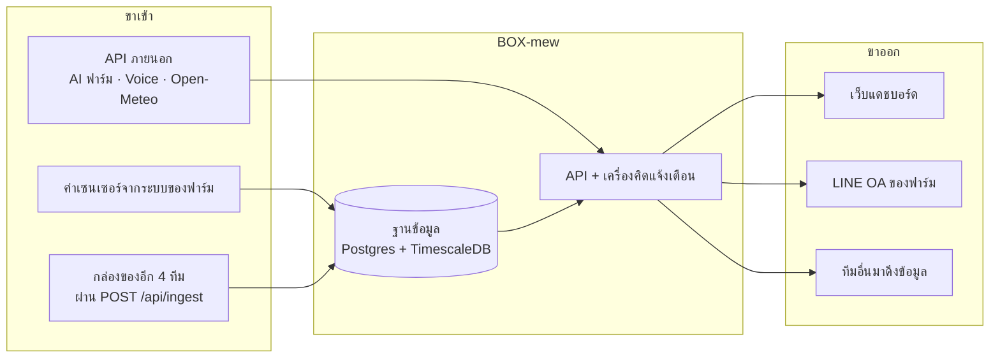
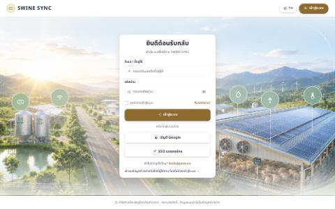
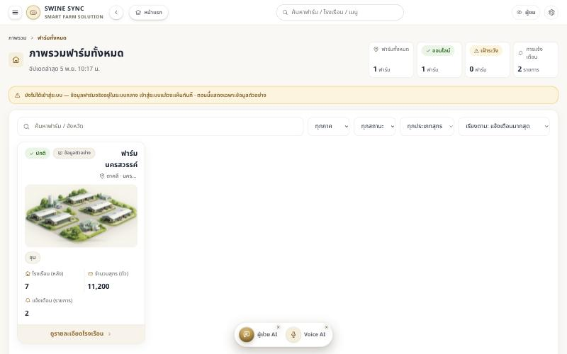
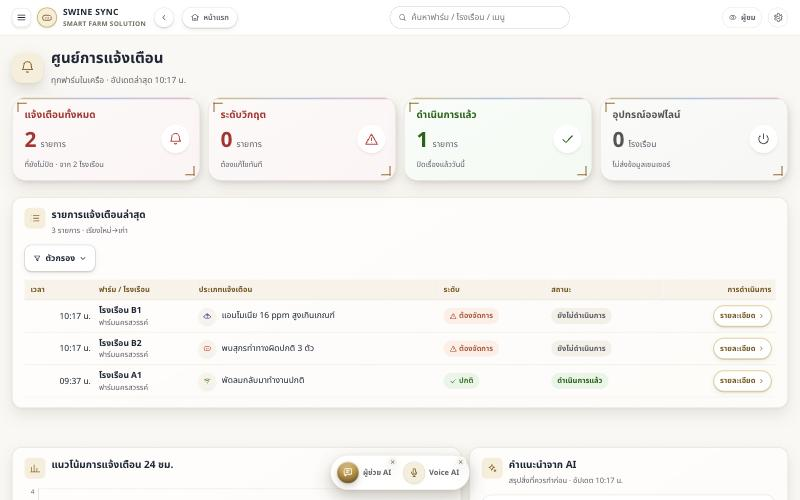
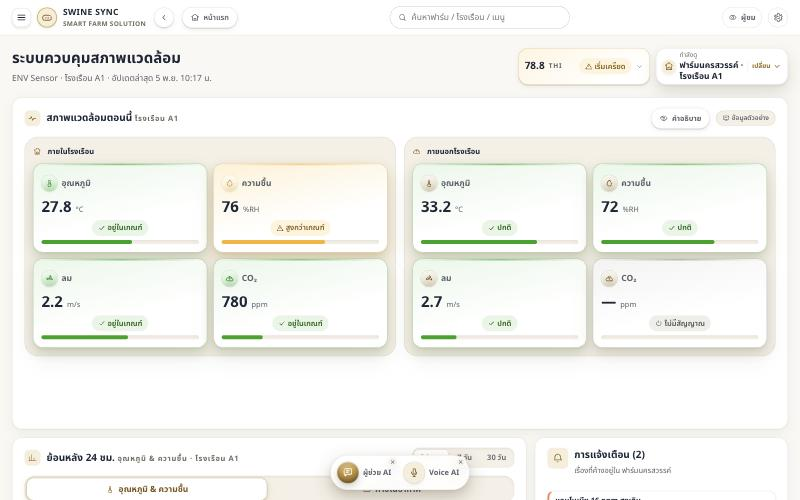
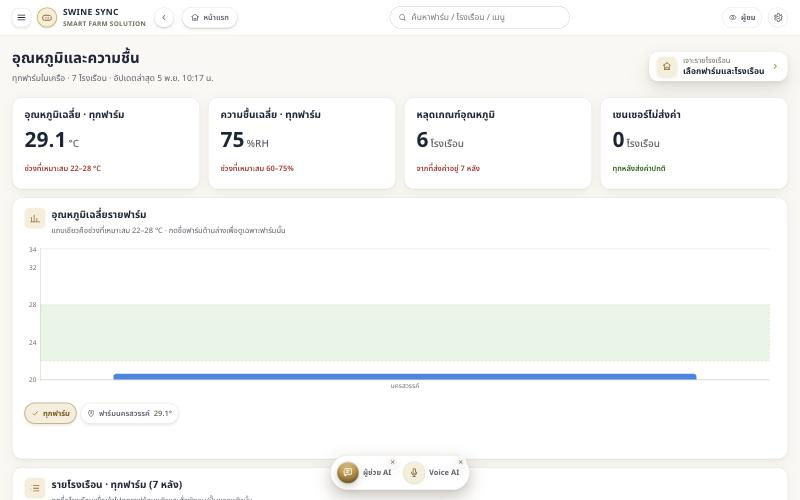
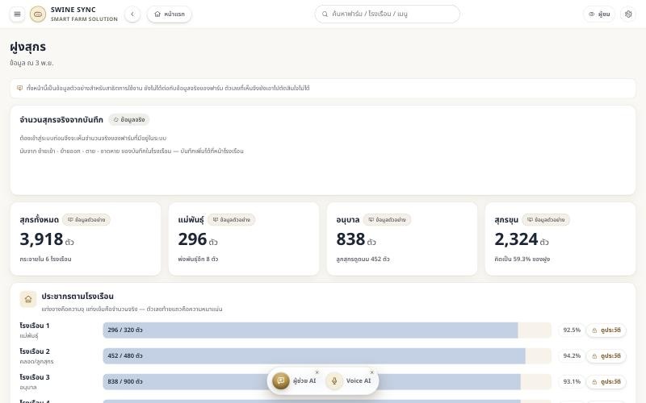
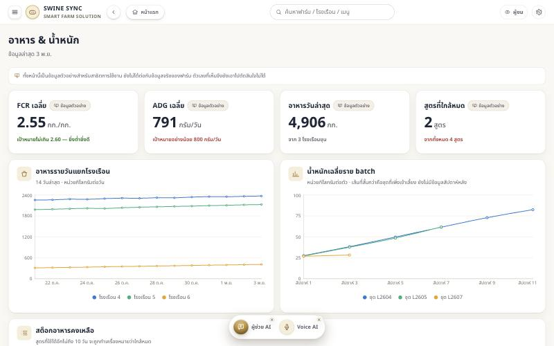
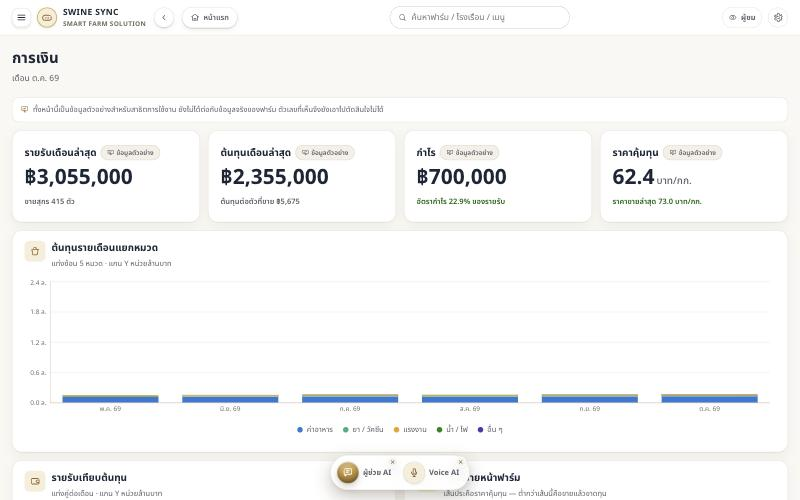

# 1 · ภาพรวมโครงการและงานที่รับผิดชอบ

[← กลับสารบัญ](README.md)

## 1.1 ที่มาและปัญหาที่ต้องการแก้

ฟาร์มสุกรของ CPF ที่จังหวัดกำแพงเพชรมีเซนเซอร์วัดสภาพแวดล้อมในโรงเรือนและมิเตอร์ไฟติดตั้งอยู่
แต่**ค่าที่วัดได้ไม่ถูกเก็บไว้ที่ไหนที่คนทั่วไปเปิดดูย้อนหลังได้** และ**ไม่มีใครได้รับแจ้งเมื่อค่าผิดปกติ**
คนที่ฟาร์มต้องเดินไปดูหน้าตู้เอง ถ้าอุณหภูมิขึ้นสูงตอนกลางคืนก็จะรู้ตอนเช้า

ปัญหาสามข้อที่ตั้งใจแก้

| ปัญหา | สิ่งที่ทำ |
| --- | --- |
| ค่าวัดไม่ถูกเก็บย้อนหลัง | เก็บลงฐานข้อมูลแบบอนุกรมเวลา · ตอนนี้มี 759,007 แถวตั้งแต่ 10 ก.ค. 2569 |
| ไม่มีใครรู้เมื่อค่าผิดปกติ | เครื่องคิดแจ้งเตือนเปิดใบเองและ **ส่งเข้า LINE OA ของฟาร์ม** |
| คนหน้างานไม่ได้นั่งหน้าคอม | ทำให้ **บันทึกงานในเล้าผ่านแชทไลน์ได้ 19 ชนิด** ไม่ต้องเปิดเว็บ |

## 1.2 วัตถุประสงค์ของระบบ

1. เก็บค่าจากเซนเซอร์จริงในโรงเรือนไว้อย่างต่อเนื่องและเปิดดูย้อนหลังได้
2. เตือนคนที่ฟาร์มทางช่องทางที่เขาใช้อยู่แล้ว (LINE) เมื่อค่าหลุดเกณฑ์
3. ให้คนหน้างานบันทึกงานประจำวันได้โดยไม่ต้องเรียนรู้โปรแกรมใหม่
4. เป็น **ที่รวมข้อมูลตรงกลางของทั้ง 5 ทีมในโครงการ** และคุมว่าใครดึงอะไรไปใช้ได้

## 1.3 งานที่รับผิดชอบ

ทั้งโครงการแบ่งเป็น 5 กล่อง (ทีม) — ส่วนงานที่เอกสารชุดนี้ส่งมอบคือ **BOX-mew**

| กล่อง | ทีม | หน้าที่ |
| --- | --- | --- |
| **BOX-mew** | **ส่วนงานนี้** | **แดชบอร์ด · ฐานข้อมูลกลาง · แจ้งเตือน · LINE · ตู้กลางรับข้อมูล 5 ทีม** |
| BOX-muey | PLC | ตู้ควบคุมอุปกรณ์ในโรงเรือน |
| BOX-jew | VISION SWINE | กล้อง AI นับสุกรและชั่งน้ำหนัก |
| BOX-dy | Easy Pairing | จับคู่เซนเซอร์กับจุดติดตั้ง |
| BOX-fern | Farmy | Voice AI ตอบคำถามด้วยเสียง |

**BOX-mew ถูกกำหนดให้เป็นที่รวมข้อมูลตรงกลาง** ทุกทีมส่งเข้ามาได้ และเจ้าของกล่องเป็นคนให้สิทธิ์ว่าใครดึงอะไรได้

## 1.4 ขอบเขตการทำงานของระบบ

**อยู่ในขอบเขต:** เก็บข้อมูล · แสดงผล · แจ้งเตือน · บันทึกงาน · รับ-จ่ายข้อมูลระหว่างทีม
**ไม่อยู่ในขอบเขต:** ตัวเซนเซอร์และตู้ควบคุมที่ฟาร์ม · การสั่งงานอุปกรณ์จริง
(อย่างแรกเป็นของทีมหน้างาน · อย่างหลังเตรียมโค้ดไว้ครบแล้วแต่รอสเปกจากทีม PLC)

## 1.5 ผลงานที่พัฒนาเสร็จแล้ว

### หน้าเว็บ 24 หน้า

| กลุ่ม | หน้า |
| --- | --- |
| ภาพรวม | ภาพรวม · ฟาร์มทั้งหมด · โรงเรือนในฟาร์ม · รายละเอียดโรงเรือน |
| สภาพแวดล้อม | สภาพแวดล้อมในเล้า · อุณหภูมิทุกโรงเรือน · เทียบระหว่างโรงเรือน · อากาศนอกเล้า · แบบจำลองโรงเรือน |
| การผลิต | ฝูงสุกร · ชนิดสุกร · อาหาร & น้ำหนัก · การเงิน |
| ปฏิบัติการ | ศูนย์การแจ้งเตือน · กล้อง AI · รายงานกะ · ผู้ช่วย AI · Voice AI |
| จัดการ | ผู้ใช้และสิทธิ์ · เข้าสู่ระบบ · ตู้กลาง (เว็บแยกอีกตัว) |
| คู่มือในแอป | โรคสุกร · การใช้ Farmy · เช็กลิสต์ · การล้างเล้า · การผสมพันธุ์ · สูตรอาหาร |

### ความสามารถหลัก

| เรื่อง | สภาพจริง 5 พ.ย. 2569 |
| --- | --- |
| เก็บค่าเซนเซอร์ | `sensor_reading` 759,007 แถว · `power_reading` 151,983 แถว |
| แจ้งเตือนอัตโนมัติ | เปิดใบเองเมื่อผิดเกณฑ์ · **ปิดใบเองเมื่อค่ากลับมาปกติ** · ตอนนี้เปิดค้าง 3 ใบ |
| ส่งเข้า LINE OA | แจ้งเตือน · สรุปรายวัน · บอทตอบคำถาม · เมนู 6 ปุ่ม |
| **บันทึกงานผ่านไลน์** | **19 ชนิด** — ตาย ป่วย ขาดหาย ย้ายเข้า-ออก คลอด หย่านม ผสม ชั่ง ให้อาหาร ให้น้ำ ให้ยา วัคซีน อาหารคงเหลือ ทำความสะอาด ซ่อม ตรวจเล้า คนเข้าเล้า จดบันทึก |
| บันทึกว่าใครทำอะไร | ตาราง `activity` · เลือกได้ว่าจะให้ส่งเข้าไลน์เรื่องไหนบ้าง |
| สิทธิ์ผู้ใช้ | 4 ระดับไล่ขั้น — ผู้ชม < ผู้บันทึก < ผู้ควบคุมอุปกรณ์ < ผู้ดูแลระบบ |
| หลายภาษา | ไทย · อังกฤษ · จีน |
| กระดานจัดเลย์เอาต์ | ลากย้าย/ยืดกล่องแล้วบันทึกเป็นชุดได้ทุกหน้า |
| ตู้กลางรับข้อมูล | `POST /api/ingest` + หน้าเว็บจัดการกุญแจ · รับแล้วจริงจาก 2 ทีม |
| กล้อง AI | ต่อผ่าน `/api/vision` แบบอ่านอย่างเดียว · ออกตั๋วชั่วคราวให้ ``/`<video>` ดูภาพได้ |
| ตรวจสุขภาพระบบ | `ops/health-check.sh` ตรวจ 6 เรื่องด้วยคำสั่งเดียว |
| เทสต์อัตโนมัติ | **876 เทสต์** ใน 73 ไฟล์ · ผ่านทั้งหมด |

### ภาพหน้าจอจริง

> ภาพทั้งหมดถ่ายจากโปรแกรมจริงที่รันอยู่เมื่อ 5 พ.ย. 2569
> ป้าย "ข้อมูลตัวอย่าง" ที่เห็นในภาพเป็นป้ายที่**ตัวโปรแกรมติดเอง**
> เพื่อบอกผู้ใช้ว่าตัวเลขส่วนไหนยังไม่ได้ต่อกับข้อมูลจริง

| | |
| --- | --- |
|  |  |
| **หน้าเข้าสู่ระบบ** — เข้าชมแบบไม่ล็อกอินได้ในสิทธิ์ผู้ชม | **ภาพรวมฟาร์มทั้งหมด** — ฟาร์มกำแพงเพชรคือฟาร์มที่ต่อเซนเซอร์จริง |
|  |  |
| **ศูนย์การแจ้งเตือน** — ทุกสถานะมีไอคอน + ข้อความ ไม่สื่อด้วยสีอย่างเดียว | **สภาพแวดล้อมในเล้า** — เทียบในเล้ากับนอกเล้าคู่กัน |
|  |  |
| **อุณหภูมิและความชื้นทุกโรงเรือน** — แถบเขียวคือช่วงที่เหมาะสม | **ฝูงสุกร** — แยกจำนวนจริงจากบันทึก กับตัวเลขตัวอย่างชัดเจน |
|  |  |
| **อาหาร & น้ำหนัก** — FCR · ADG · สต็อกอาหาร | **การเงิน** — รายรับ ต้นทุน กำไร ราคาคุ้มทุน |

## 1.6 ส่วนที่ยังไม่สมบูรณ์

| เรื่อง | สภาพตอนนี้ |
| --- | --- |
| **สั่งงานอุปกรณ์** | โค้ดครบทุกด่านแล้ว แต่ตั้งเป็น `hold` คือเก็บคำสั่งไว้ **ไม่ส่งออกไปไหน** รอสเปกจากทีม PLC |
| หน้าฝูงสุกร · อาหาร · การเงิน | ยังเป็นข้อมูลตัวอย่าง (ตัวโปรแกรมติดป้ายบอกไว้) เพราะยังไม่มีระบบต้นทางให้ต่อ |
| เซนเซอร์โซน A และ C | ติดตั้งแล้วแต่ส่งค่า 0 มาตลอด — ระบบทิ้งค่า 0 ทิ้งโดยตั้งใจ ใช้งานได้จริงแค่โซน B |
| เซนเซอร์นอกอาคาร | ค่าค้าง ไม่ได้วัดจริง (ของทีมหน้างาน) |
| Voice AI | ฝังหน้าได้แล้ว แต่ยังไม่มี SSO จึงถามเรื่องในฟาร์มจากกรอบเต็มจอไม่ได้ |
| กล้อง AI | ฝั่ง BOX-mew ต่อครบ · เครื่อง Jetson ของทีมนั้นออฟไลน์ตั้งแต่ ~31 ต.ค. |

➜ รายละเอียดและลำดับความสำคัญอยู่ใน [ข้อ 10](10-%E0%B8%AA%E0%B8%96%E0%B8%B2%E0%B8%99%E0%B8%B0%E0%B8%87%E0%B8%B2%E0%B8%99%E0%B9%81%E0%B8%A5%E0%B8%B0%E0%B8%87%E0%B8%B2%E0%B8%99%E0%B8%95%E0%B9%88%E0%B8%AD%E0%B9%84%E0%B8%9B.md)
