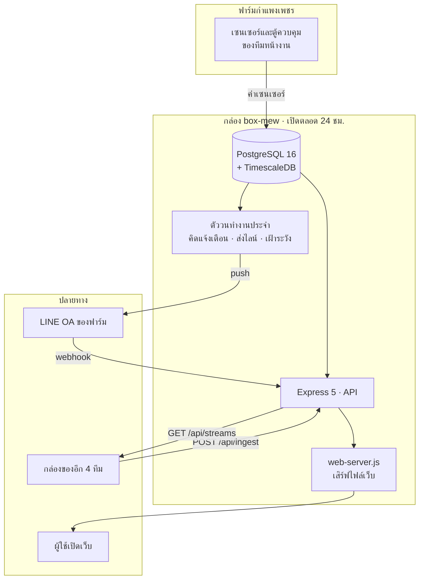
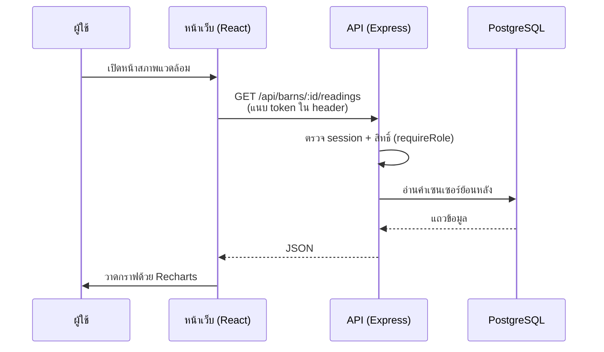
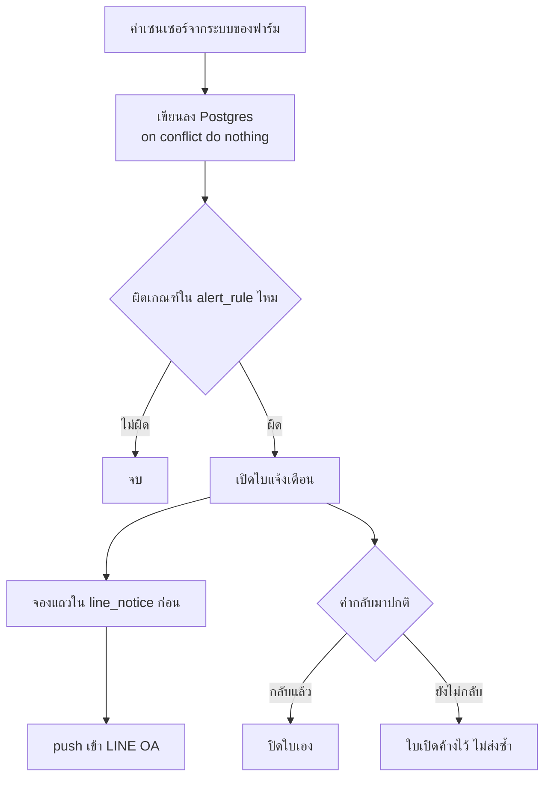

# 4 · โครงสร้างโปรแกรมและสถาปัตยกรรมระบบ

[← กลับสารบัญ](README.md)

## 4.1 ภาพรวมสถาปัตยกรรม

★ **ค่าเซนเซอร์มาจากระบบของฟาร์มเอง** ส่วนงานนี้เป็นปลายทางที่รับมาเก็บลงฐานข้อมูล
แล้วเอาไปแสดงผลและคิดแจ้งเตือนต่อ — **ตัวเซนเซอร์และตู้ควบคุมเป็นของทีมหน้างาน**
ส่วนกล่องของอีก 4 ทีมเข้ามาทาง `POST /api/ingest` ซึ่งเป็นคนละเส้นทางกันสิ้นเชิง

## 4.2 ภาษาและเครื่องมือที่ใช้

### หน้าบ้าน (Frontend)

| สิ่งที่ใช้ | เวอร์ชัน | ทำหน้าที่อะไร |
| --- | --- | --- |
| React | 19.2.8 | สร้างหน้าจอ |
| react-router-dom | 7.18.2 | จัดการเส้นทางของแต่ละหน้า |
| Recharts | 3.10.1 | กราฟทุกกราฟในระบบ |
| Vite | 8.2.0 | เครื่องมือ build และ dev server |
| oxlint | 1.75.0 | ตรวจคุณภาพโค้ด |

★ **มี dependency แค่ 4 ตัว โดยตั้งใจ** — กติกาของโปรเจกต์คือห้ามเพิ่มไลบรารีใหม่
โดยไม่จำเป็น แม้แต่แผนที่ก็เขียนเองไม่ได้ใช้ไลบรารีแผนที่

### หลังบ้าน (Backend)

| สิ่งที่ใช้ | เวอร์ชัน | ทำหน้าที่อะไร |
| --- | --- | --- |
| Node.js | ≥ 22 (ใช้จริง v25.8.0) | ตัวรันโปรแกรม |
| Express | 5.1.0 | เว็บเซิร์ฟเวอร์และ API |
| pg | 8.16.3 | ต่อ PostgreSQL |
| node-pg-migrate | 8.0.4 | จัดการการเปลี่ยนโครงตาราง |
| pino | 9.13.1 | เขียน log |
| zod | 4.1.13 | ตรวจความถูกต้องของข้อมูลที่รับเข้ามา |

### ฐานข้อมูลและโครงสร้างพื้นฐาน

| สิ่งที่ใช้ | รายละเอียด |
| --- | --- |
| PostgreSQL 16 + TimescaleDB | `timescale/timescaledb-ha:pg16` · ฐานชื่อ `swinesync` · **30 ตาราง** |
| Docker Compose | ใช้ตอนรันบนเครื่องที่ใช้พัฒนา · ★ **กล่องจริงไม่มี Docker** |
| Tailscale | เครือข่ายส่วนตัวสำหรับเข้ากล่อง |

## 4.3 หน้าบ้านกับหลังบ้านคุยกันอย่างไร

- **การยืนยันตัวตน** ใช้ token ที่ออกตอนเข้าสู่ระบบ เก็บไว้ที่เครื่องผู้ใช้ แนบไปกับทุกคำขอ
- **สิทธิ์ถูกตรวจสองชั้น** — ฝั่งหน้าเว็บปิดปุ่มพร้อมบอกเหตุผล ฝั่งเซิร์ฟเวอร์ตรวจซ้ำด้วย `requireRole`
  ★ ปิดปุ่มอย่างเดียวไม่นับว่าปลอดภัย เพราะคนยิง API ตรงได้
- **ภาพจากกล้อง** ใช้ **ตั๋วชั่วคราวอายุ 60 วินาที** แทน token เพราะแท็ก `` กับ `<video>`
  แนบ header ไม่ได้ · ★ **ห้ามเอา token ของผู้ใช้ไปใส่ใน URL เด็ดขาด**

## 4.4 การเชื่อมต่อฐานข้อมูล

| เรื่อง | รายละเอียด |
| --- | --- |
| ที่อยู่ | ฐานหลัก **มีที่เดียวคือบนกล่อง** ไม่มีสำเนาที่ใช้งานอยู่ที่อื่น |
| ตารางอนุกรมเวลา | `sensor_reading` · `power_reading` · `ingest_reading` เป็น hypertable ของ TimescaleDB |
| เก็บย้อนหลัง | ค่าดิบตาม `RAW_RETENTION_DAYS` · บีบอัดหลัง `COMPRESS_AFTER_DAYS` |
| แก้โครงตาราง | ต้องเขียนไฟล์ migration ใหม่เสมอ **ห้ามแก้ตารางด้วยมือ** · ตอนนี้มี 23 ไฟล์ |
| กันแถวซ้ำ | เขียนด้วย `on conflict do nothing` ส่งซ้ำกี่รอบก็ไม่เกิดแถวซ้ำ |

**30 ตารางในฐาน** แบ่งตามหน้าที่

| กลุ่ม | ตาราง |
| --- | --- |
| โครงสร้างฟาร์ม | `company` `farm` `barn` `device` `sensor_source_map` |
| ค่าที่วัดได้ | `sensor_reading` `power_reading` |
| แจ้งเตือน | `alert` `alert_rule` |
| ผู้ใช้และสิทธิ์ | `app_user` `session` `user_farm` `user_pref` `auth_event` |
| ไลน์ | `line_user` `line_notice` `line_health` |
| บันทึกงาน | `barn_log` `activity` `shift_handover` |
| สั่งอุปกรณ์ | `control_device` `control_command` |
| ตู้กลาง | `source_box` `ingest_stream` `ingest_reading` `ingest_event` `stream_grant` |
| อื่น ๆ | `layout_preset` `system_setting` `pgmigrations` |

## 4.5 การเชื่อมต่อ API

### API ของระบบนี้ — 16 หมวด

| เส้นทาง | ใช้ทำอะไร |
| --- | --- |
| `/api/auth` | เข้าสู่ระบบ · ออกจากระบบ |
| `/api/users` | จัดการผู้ใช้และสิทธิ์ |
| `/api/farms` | ฟาร์มและโรงเรือน |
| `/api/barns` | ค่าเซนเซอร์ย้อนหลัง + รายงาน |
| `/api/barn-logs` | บันทึกงานในเล้า 19 ชนิด |
| `/api/alerts` | ใบแจ้งเตือนและเกณฑ์ |
| `/api/activity` | บันทึกว่าใครทำอะไร |
| `/api/control` · `/api/control/outbox` | สั่งอุปกรณ์ (ยัง `hold`) |
| `/api/ingest` | ★ **ทีมอื่นส่งข้อมูลเข้ามา** |
| `/api/hub` | จัดการกล่องและกุญแจของตู้กลาง |
| `/api/streams` | ★ **ทีมอื่นมาดึงข้อมูลออก** |
| `/api/vision` | ภาพและผลตรวจจับจากกล้อง AI |
| `/api/assistant` · `/api/farmy` | ผู้ช่วย AI และ Voice AI |
| `/api/forecast` | พยากรณ์อากาศ (Open-Meteo) |
| `/api/line` | webhook ของไลน์ + ผูกบัญชี |

## 4.6 ทางเดินของข้อมูล (Data Flow)

★ **สองกติกาในแผนภาพนี้ที่เกิดจากบทเรียนจริง อย่าแก้โดยไม่อ่าน [ข้อ 9](09-%E0%B8%9B%E0%B8%B1%E0%B8%8D%E0%B8%AB%E0%B8%B2%E0%B9%81%E0%B8%A5%E0%B8%B0%E0%B9%81%E0%B8%99%E0%B8%A7%E0%B8%97%E0%B8%B2%E0%B8%87%E0%B9%81%E0%B8%81%E0%B9%89.md)**

1. **ทิ้งค่าที่เป็นไปไม่ได้** — อุปกรณ์ที่อ่าน RS485 ไม่ได้จะคืน `0` มา
   `0 °C` ในโรงเรือนสุกรคือ "ไม่มีค่า" ไม่ใช่ค่าที่วัดได้ ถ้าไม่ทิ้ง กราฟจะดิ่งลงพื้นทุกครั้ง
2. **จองแถวก่อนส่ง ไม่ใช่ส่งก่อนแล้วค่อยบันทึก** — ของเดิมส่งก่อน พอบันทึกพังตัวชี้ไม่ขยับ
   แล้ว**ส่งซ้ำไม่รู้จบทุก 30 วินาที** เสียโควตาไลน์ไป 177 ข้อความใน 2 วัน

## 4.7 การเชื่อมต่อกับระบบภายนอกและทีมอื่น

| ระบบ | ทิศทาง | วิธีต่อ |
| --- | --- | --- |
| ตู้ควบคุมที่ฟาร์ม | เข้า | ค่าเซนเซอร์เข้าฐานข้อมูล |
| กล่องของอีก 4 ทีม | เข้า | `POST /api/ingest` พร้อมกุญแจ |
| ทีมที่ได้รับสิทธิ์ | ออก | `GET /api/streams` ตาม `stream_grant` |
| LINE OA | ทั้งสองทาง | push/broadcast ออก · webhook เข้า |
| AI ของฟาร์ม | ออก | เรียก REST · **กุญแจอยู่ฝั่งเซิร์ฟเวอร์เท่านั้น** |
| Voice AI (Farmy) | ออก | ฝัง iframe + เรียก REST |
| Open-Meteo | ออก | REST ฟรี ไม่ต้องมีกุญแจ |
| กล้อง AI (Jetson + NAS) | ออก | ผ่าน `tailnet-relay` แล้ว proxy ด้วย `/api/vision` |

➜ รายละเอียดแต่ละทีมอยู่ใน [ข้อ 7](07-%E0%B9%80%E0%B8%8A%E0%B8%B7%E0%B9%88%E0%B8%AD%E0%B8%A1%E0%B8%95%E0%B9%88%E0%B8%AD%E0%B8%81%E0%B8%B1%E0%B8%9A%E0%B9%81%E0%B8%95%E0%B9%88%E0%B8%A5%E0%B8%B0%E0%B8%97%E0%B8%B5%E0%B8%A1.md)
