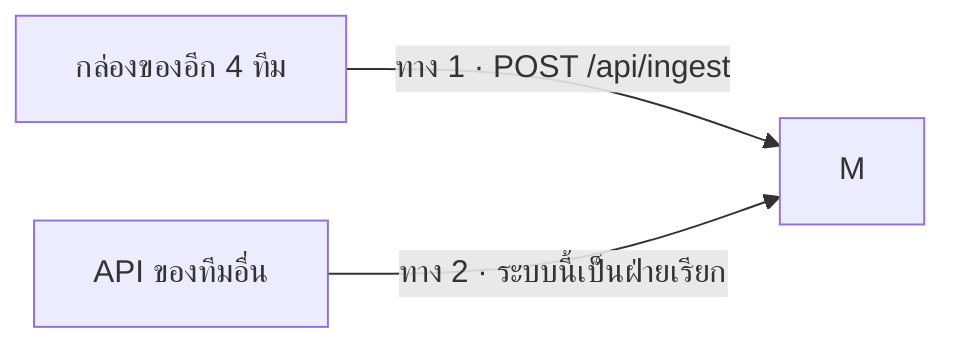
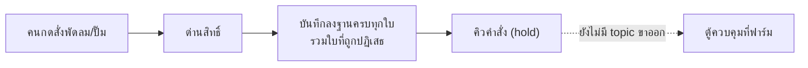

# 7 · วิธีรับและเชื่อมต่อข้อมูลจากแต่ละทีม

[← กลับสารบัญ](README.md)

## 7.1 มีสองทางที่ข้อมูลเข้ามาหาระบบนี้



| ทาง | ใครส่ง | เข้ามาที่ไหน | สภาพ 5 พ.ย. 2569 |
| --- | --- | --- | --- |
| **1 · ตู้กลาง** | `dy` `fern` `jew` `muey` | `POST /api/ingest` | `fern` ส่งจริง 26 รายการ · `dy` ยังเป็นชุดทดสอบ · `jew` `muey` มีกุญแจแล้วยังไม่ส่ง |
| **2 · เรียก API เขา** | AI ฟาร์ม · Voice AI · Open-Meteo · กล้อง AI | หลังบ้านของระบบนี้เรียกต่อให้ | AI ตอบได้ · Voice ติด SSO · กล้องออฟไลน์ |

---

## 7.2 ค่าเซนเซอร์ของฟาร์ม

**ค่าเซนเซอร์ในโรงเรือนมาจากระบบของฟาร์มเอง และเข้ามาอยู่ในฐานข้อมูลบนกล่องแล้ว**
อยู่ในตาราง `sensor_reading` กับ `power_reading` — หน้าจอ เครื่องคิดแจ้งเตือน
และสรุปรายวันอ่านจากสองตารางนี้ทั้งหมด

★ **ตัวเซนเซอร์และตู้ควบคุมเป็นของทีมหน้างาน ไม่ใช่ของส่วนงานนี้**
ค่าใหม่ไม่เข้าเมื่อไรต้องถามทีมนั้น และ **ค่าที่ขาดไปช่วงหนึ่งดึงย้อนหลังกลับมาไม่ได้**

---

## 7.3 ทาง 1 — ตู้กลางรับข้อมูลจาก 4 ทีม

### วิธีส่ง

```
POST https://mew.plotnexuslab.com/api/ingest
Authorization: Bearer <กุญแจประจำกล่อง>
Content-Type: application/json
```

### รูปแบบข้อมูล — รับสามชนิด

| ชนิด | ต้องมีอะไร | ใช้กับอะไร |
| --- | --- | --- |
| `reading` | `value` เป็นตัวเลข | ค่าวัดตามเวลา เช่น อุณหภูมิชิป |
| `event` | `payload` เป็น JSON | เหตุการณ์ เช่น บันทึกวัคซีน สรุปรายวัน |
| `file` | `url` | ★ **เก็บแค่ที่อยู่ ไม่เก็บตัวไฟล์** |

ตัวอย่างก้อนที่ส่งเข้ามา

```json
{
  "items": [
    { "type": "reading", "name": "chip.temp", "value": 42.5, "unit": "°C", "at": "2026-11-05T03:00:00Z" },
    { "type": "event",   "name": "vaccine.log", "payload": { "barn": "A1", "dose": 2 } },
    { "type": "file",    "name": "cam.clip", "url": "https://.../clip.mp4", "fileType": "video/mp4" }
  ]
}
```

### กติกาที่ต้องบอกทีมอื่นเสมอ

| กติกา | เหตุผล |
| --- | --- |
| **ผิดรายการเดียว = ไม่เข้าทั้งก้อน** | ตอบกลับว่ารายการที่เท่าไรผิดเพราะอะไร |
| ครั้งละไม่เกิน **500 รายการ** | กันก้อนใหญ่เกินไป |
| ส่ง `at` ซ้ำเวลาเดิม = **ทับค่าเดิม** | ยิงซ้ำหลังเน็ตหลุดได้อย่างปลอดภัย |
| ไม่ส่ง `at` = ใช้เวลาที่มาถึง | — |
| **ชื่อชุดข้อมูลทีมอื่นตั้งเองได้** | ตู้กลางขึ้นทะเบียนให้เองตอนเห็นครั้งแรก ไม่ต้องรอผู้ดูแลเปิดให้ |
| **ชื่อย่อกล่องเปลี่ยนไม่ได้** | เปลี่ยนแล้วข้อมูลเก่าจะหาไม่เจอ |

### ★ สิทธิ์ดึงข้อมูลออก

```
GET https://mew.plotnexuslab.com/api/streams
```

- **ค่าตั้งต้นคือดึงไม่ได้เลย** ต้องมีแถวใน `stream_grant` ก่อน
- ★ ชุดที่ไม่มีสิทธิ์ตอบ **404 เหมือนชุดที่ไม่มีจริง ไม่ใช่ 403**
  เพื่อไม่ให้ใครไล่เดาได้ว่าทีมอื่นมีชุดข้อมูลอะไรบ้าง

### การจัดการกุญแจ

ออก · เพิกถอน · ดูประวัติ ที่หน้า `/hub` (เว็บคนละตัวกับแดชบอร์ด)

⚠ **ส่งกุญแจตัวต่อตัวเท่านั้น ห้ามลงกลุ่มรวม**
⚠ **ห้ามเขียนกุญแจจริงลงในเอกสารหรือไฟล์ที่อยู่ใน Git**

### ของที่รับเข้ามาแล้วจริง

| ชุดข้อมูล | จากทีม | ชนิด | จำนวน | ล่าสุด |
| --- | --- | --- | --- | --- |
| `test.chip_temp` | `dy` (Easy Pairing) | reading | 333 | 30 ต.ค. 2569 |
| `daily.summary` | `fern` (Farmy) | event | 7 | 4 พ.ย. 2569 |
| `vaccine.log` | `fern` (Farmy) | event | 19 | 29 ต.ค. 2569 |

---

## 7.4 ทาง 2 — API ของทีมอื่นที่ระบบนี้เป็นฝ่ายเรียก

| ของใคร | ตั้งค่าที่ | ★ ที่ต้องรู้ |
| --- | --- | --- |
| **AI ของฟาร์ม** | `CPF_AI_URL` · `CPF_AI_API_KEY` | **กุญแจอยู่ฝั่งเซิร์ฟเวอร์เท่านั้น ห้ามย้ายมาฝั่งหน้าเว็บ** · ★ ผู้ใช้ใหม่ต้องให้ทีมนั้นลงทะเบียนก่อน ไม่งั้นได้ 401 · แปลงชื่อผู้ใช้ที่ `CPF_AI_USER_MAP` |
| **Voice AI (Farmy)** | `FARMY_URL` · `FARMY_USERNAME` · `FARMY_PASSWORD` | ฝังในหน้า `/dashboard/voice` · ★ โฮสต์ฟรี**หลับเมื่อไม่มีคนใช้** ครั้งแรกของวันรอ 30–60 วินาที **ไม่ใช่ลิงก์เสีย** · ยังไม่มี SSO จึงถามเรื่องในฟาร์มจากกรอบเต็มจอไม่ได้ |
| **Open-Meteo** | ไม่ต้องมีกุญแจ | ★ เป็นค่า**ทำนาย** **ห้ามเอาไปปนกับค่าที่เสาอากาศวัดได้** ต่างกันหลายองศาได้โดยที่ทั้งคู่ไม่ได้พัง |
| **กล้อง AI (VISION SWINE)** | ผ่าน `tailnet-relay` → `/api/vision` | อ่านอย่างเดียว · มี allowlist · ★ ภาพใช้**ตั๋วชั่วคราว 60 วินาที** ไม่ใช่ token |
| **PlotNexus** | `VITE_PLOTNEXUS_ENABLED` · `PLOTNEXUS_ENABLED` | ★ ถูกถอนสิทธิ์ตอบ 403 ตั้งแต่ 11 ก.ย. 2569 · ปิดการเรียกไว้ทั้งสองฝั่งแล้ว **ไม่ขวางงาน** |

---

## 7.5 ขาออก — สั่งอุปกรณ์ (ยังไปไม่ถึงตู้)



ฝั่ง BOX-mew ทำครบทุกด่านแล้ว — ตรวจสิทธิ์ · ตรวจค่าที่สั่ง · บันทึกทุกใบ
ที่ขาดคือ **สเปกของปลายทาง** ว่าต้องส่ง topic อะไร หน้าตาข้อมูลแบบไหน

★ **ตั้งใจไม่เดาเอง** — เดาผิดแล้วโชคดีคือไม่มีอะไรเกิดขึ้น
เดาผิดแล้วโชคร้ายคือ**พัดลมในโรงเรือนจริงหยุด**

### ★ เจ็ดอย่างที่ยังต้องขอจากทีม PLC

เนื้อหานี้เคยอยู่ในจดหมายขอสิทธิ์แยกไฟล์ · ย้ายมาไว้ที่นี่เพื่อให้คนรับช่วงเห็นในที่เดียว

| # | สิ่งที่ขาด | ทำไมต้องมี |
| --- | --- | --- |
| 1 | **topic ขาออกของแต่ละอุปกรณ์** — พัดลม `FAN 1`–`FAN 5` · ปั๊มน้ำดื่ม `P1` · ปั๊มระบายน้ำ `P2` · ปั๊มม่านน้ำ `P3` | ไม่รู้ว่าจะ publish ไปที่ไหน |
| 2 | **รูปข้อมูลที่ตู้รับ** | ส่งผิดรูป ตู้ไม่ทำตาม หรือทำผิดอย่าง |
| 3 | **ช่องทางและบัญชีที่ใช้ส่งคำสั่งได้** | ★ คำสั่งต้องไม่วิ่งผ่านช่องทางสาธารณะ |
| 4 | **รายชื่ออุปกรณ์จริงของโรงเรือน A1** | รหัสที่เว็บใช้ต้องตรงกับของจริง |
| 5 | **ช่วงค่าที่ยอมรับและคำสั่งที่รองรับ** — ตั้งไว้ `on` `off` `speed` `auto` · พัดลม 20–60 Hz · ปั๊มปรับรอบไม่ได้ | ขอให้ยืนยันหรือแก้ |
| 6 | **ช่องทางที่ตู้ตอบกลับว่าทำตามแล้ว** | ★★ **ข้อที่ขาดมากที่สุด** — ไม่มีข้อนี้ หน้าจอจะบอกได้แค่ "ส่งออกไปแล้ว" ไม่ใช่ "พัดลมหมุนแล้ว" |
| 7 | **ข้อจำกัดฝั่งตู้** เช่น สั่งถี่ได้แค่ไหน สั่งพร้อมกันได้กี่ตัว | กันการสั่งรัวจนตู้รับไม่ไหว |

★ **ช่องทางนี้ไม่ใช่ปุ่มหยุดฉุกเฉิน** — ของจริงต้องหยุดที่หน้าตู้เสมอ

---

## 7.6 ผู้ประสานงานแต่ละส่วน

| เรื่อง | ทีม / กล่อง |
| --- | --- |
| ตู้ควบคุมและเซนเซอร์ที่ฟาร์ม | ทีม PLC · BOX-muey |
| กล้อง AI นับสุกร/ชั่งน้ำหนัก | ทีม VISION SWINE · BOX-jew |
| จับคู่เซนเซอร์กับจุดติดตั้ง | ทีม Easy Pairing · BOX-dy |
| Voice AI | ทีม Farmy · BOX-fern |
| API กลางของโครงการ (`lab.plotnexuslab.com`) | พี่เลี้ยงโครงการ |
| แดชบอร์ด ฐานข้อมูล ตู้กลาง | **BOX-mew — ส่วนงานนี้** |

★ ชื่อและช่องทางติดต่อรายบุคคล **ไม่เขียนไว้ในเอกสารที่อยู่ใน Git** —
ขอจากผู้ดูแลระบบเดิมหรือหัวหน้าโครงการ
