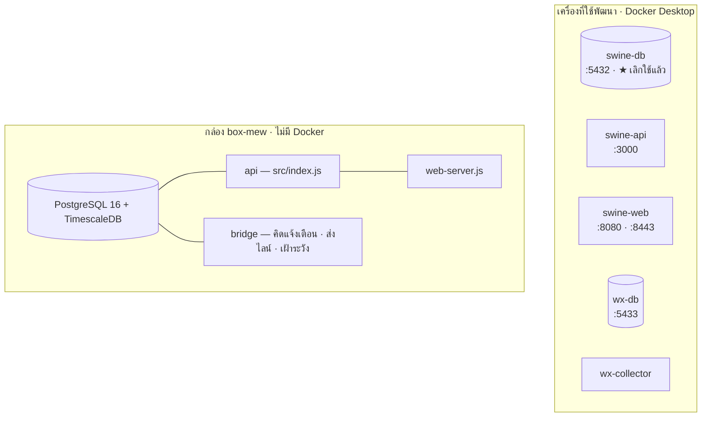

# 8 · ระบบ Container และการเชื่อมต่อระหว่างบริการ

[← กลับสารบัญ](README.md)

## 8.1 ★ อ่านข้อนี้ก่อน — มีสองเครื่อง คนละแบบกัน

| | เครื่องที่ใช้พัฒนา | กล่อง `box-mew` |
| --- | --- | --- |
| ใช้ Docker ไหม | **ใช้** `docker compose` | ★ **ไม่ใช้เลย** รันเป็นโปรเซสตรง ๆ |
| ทำหน้าที่อะไร | สำเนาไว้ลองของตอนแก้โค้ด | **ของจริงทั้งหมดอยู่ที่นี่** |
| เปิดตลอดไหม | ไม่ — เปิดเฉพาะตอนทำงาน | เปิดตลอด 24 ชม. |

**ที่คนมักเข้าใจผิด:** เห็น `docker-compose.yml` แล้วคิดว่าของจริงรันด้วย Docker — **ไม่ใช่**
ไฟล์นั้นใช้ตอนรันบนเครื่องที่ใช้พัฒนาเท่านั้น



## 8.2 บริการบนเครื่องที่ใช้พัฒนา

| ชื่อ | อิมเมจ | พอร์ต | หน้าที่ | สภาพ 5 พ.ย. 2569 |
| --- | --- | --- | --- | --- |
| `swine-api` | `cpf_dashboard-api` | `127.0.0.1:3000` | API สำเนาสำหรับพัฒนา | รันอยู่ 7 วัน |
| `swine-web` | `cpf_dashboard-web` | `8080` · `8443` | เสิร์ฟหน้าเว็บสำหรับพัฒนา | รันอยู่ 7 วัน |
| `swine-db` | `timescale/timescaledb-ha:pg16` | `127.0.0.1:5432` | ★ **เลิกใช้แล้ว** ข้อมูลค้างที่ 29 ก.ย. | รันอยู่ แต่ไม่มีใครเขียน |
| `swine-sim` | `cpf_dashboard-sim` | — | ตัวจำลองเซนเซอร์ | หยุดไว้ (ตั้งใจ) |
| `wx-db` | `timescale/timescaledb-ha:pg16` | `127.0.0.1:5433` | คลังข้อมูลเทรนโมเดล — **คนละระบบ** | รันอยู่ |
| `wx-collector` | `weather-wx-collector` | — | เก็บข้อมูลให้คลังเทรนโมเดล | รันอยู่ |

★★ **อย่าลบ `swine-db`** แม้จะไม่ได้ใช้แล้ว — เป็นสำเนาชุดเดียวที่อยู่นอกกล่อง

## 8.3 Network และ Volume

| ประเภท | ชื่อ | ใช้ทำอะไร |
| --- | --- | --- |
| Network | `cpf_dashboard_default` | บริการของแดชบอร์ดคุยกันเอง |
| Network | `weather_default` | ★ คลังเทรนโมเดล **แยกเครือข่ายคนละวง** |
| Volume | `cpf_dashboard_db-data` | ข้อมูลของ `swine-db` |
| Volume | `cpf_dashboard_bridge_state` | ไฟล์สถานะของตัวเฝ้าระวัง |
| Volume | `weather_wx-data` | ข้อมูลคลังเทรนโมเดล |
| Bind mount | `./docs → /hostdisk:ro` | ★ **ให้ตัวเฝ้าวัดที่ว่างของดิสก์เครื่องจริง** |

★★ **ทำไมต้อง bind mount `./docs` เข้าไปเป็น `/hostdisk`**
ในคอนเทนเนอร์ `/` คือดิสก์ของ Docker **ไม่ใช่ของเครื่อง** — วัดจากตรงนั้นได้ "ว่าง 416 GB"
ขณะที่เครื่องจริงเหลือ 7.8 GB จึงต้องผูกโฟลเดอร์จากเครื่องจริงเข้ามาไว้วัดโดยเฉพาะ

## 8.4 บริการบนกล่อง `box-mew`

| โปรแกรม | หน้าที่ |
| --- | --- |
| PostgreSQL 16 + TimescaleDB | ★ **ฐานข้อมูลหลัก มีที่นี่ที่เดียว** ชื่อฐาน `swinesync` |
| `src/index.js` | API — `https://mew.plotnexuslab.com/api` |
| `src/bridge/index.js` | ตัววนทำงานประจำ — คิดแจ้งเตือน · ส่งไลน์ · เฝ้าระวัง |
| `tailnet-relay.js` | สะพานให้กล่องต่อออกไปหาเครื่องในเทลเน็ตได้ |
| `web-server.js` | เสิร์ฟไฟล์หน้าเว็บ |

### ★★ กล่องไม่มีตัวคุมโปรแกรม

`PID 1` ของกล่องคือ `sleep infinity` **ไม่ใช่ systemd** ตามมาสองเรื่อง

| เรื่อง | ผล |
| --- | --- |
| โปรแกรมตาย | **ไม่มีอะไรเปิดใหม่ให้** ต้องเข้าไปเปิดเอง |
| process ที่ตายค้าง | เป็น **zombie ถาวร** — 5 พ.ย. นับได้ 13 ตัว |

zombie ไม่กินซีพียูหรือแรม แต่ทำให้ `ps` อ่านยาก **อย่าตกใจว่าโปรแกรมรันซ้ำหลายตัว**
ดูคอลัมน์ `stat` ถ้าขึ้น `Z` คือศพ ไม่ใช่ตัวที่รันอยู่

```bash
ssh root@<ที่อยู่ของกล่อง> 'ps -eo pid,ppid,stat,etime,args | grep -v " Z"'
```

## 8.5 ★ สองข้อห้ามเรื่องการรันบริการ

1. **ห้ามรันสะพานบทบาท `alerts` หรือ `full` สองที่พร้อมกันบนฐานเดียวกัน**
   จะเปิดใบแจ้งเตือนซ้ำ และคนที่ฟาร์มจะได้ข้อความไลน์**สองชุด**
2. **หลังบ้านของตัวกล่องเอง (เปิด/ปิด/รีสตาร์ตเครื่อง) ไม่ใช่สิทธิ์ของผู้ดูแลระบบนี้**
   ต้องแจ้งเจ้าของกล่อง · ใส่ชื่อผู้ติดต่อไว้ที่ `PRIMARY_OWNER` ใน `.env`
   แล้วข้อความแจ้งเตือนจะบอกชื่อนั้นให้เลย

## 8.6 Environment Variables ทั้งหมด

★ **ค่าจริงอยู่ในไฟล์ `.env` ซึ่งไม่อยู่ใน Git** หน้านี้บอกแค่ชื่อและหน้าที่

| กลุ่ม | ชื่อค่า | ใช้ทำอะไร |
| --- | --- | --- |
| ฐานข้อมูล | `POSTGRES_USER` `POSTGRES_PASSWORD` `POSTGRES_DB` `DB_PORT` `REMOTE_DATABASE_URL` | ต่อฐาน |
| พอร์ต | `API_PORT` `WEB_PORT` `HTTPS_PORT` | พอร์ตของแต่ละบริการ |
| ผู้ดูแลคนแรก | `ADMIN_USERNAME` `ADMIN_PASSWORD` `ADMIN_DISPLAY_NAME` | สร้างบัญชีตั้งต้น |
| รีเซ็ตรหัส | `RESET_USER` `RESET_PASSWORD` | ใช้กับ `npm run reset:password` |
| เก็บข้อมูล | `RAW_RETENTION_DAYS` `COMPRESS_AFTER_DAYS` | เก็บย้อนหลังกี่วัน บีบอัดเมื่อไร |
| ไลน์ | `LINE_CHANNEL_ACCESS_TOKEN` `LINE_CHANNEL_SECRET` `LINE_TARGET` `LINE_NOTIFY` `LINE_DRY_RUN` `LINE_DAILY_AT` `LINE_MAX_PER_DAY` `LINE_ALERT_LEVELS` `LINE_ALERT_COOLDOWN_HOURS` `LINE_ALERT_MAX_AGE_MIN` | ★ `LINE_DRY_RUN=1` คือลองโดยไม่ส่งจริง |
| เฝ้ากล่อง | `PRIMARY_HEALTH_URL` `PRIMARY_NAME` `PRIMARY_OWNER` `PRIMARY_CHECK_MIN` `PRIMARY_REMIND_MIN` `PRIMARY_WATCH_NOTIFY` | T1.285 |
| เฝ้าการไหล | `FLOW_DISK_PATH` `FLOW_MIN_DISK_PCT` `FLOW_MAX_AGE_MIN` `FLOW_CHECK_MIN` `FLOW_REMIND_MIN` `FLOW_WATCH_NOTIFY` | T1.295 · T1.297 |
| AI ของฟาร์ม | `CPF_AI_URL` `CPF_AI_API_KEY` `CPF_AI_USER_ID` `CPF_AI_USER_MAP` `CPF_AI_LEVEL` | ★ กุญแจอยู่ฝั่งเซิร์ฟเวอร์เท่านั้น |
| Voice AI | `FARMY_URL` `FARMY_USERNAME` `FARMY_PASSWORD` | — |
| สั่งอุปกรณ์ | `CONTROL_TRANSPORT` `CONTROL_OUTBOX_TOKEN` | ★ ค่าตั้งต้น `hold` |
| อื่น ๆ | `CORS_ORIGINS` `DASHBOARD_URL` `SIM_INTERVAL_SEC` | — |

## 8.7 คำสั่งที่ใช้ดูแล Container

เปิดทุกบริการ

```bash
docker compose up -d
```

ดูสถานะ

```bash
docker compose ps
```

ดู log แบบไหลต่อเนื่อง

```bash
docker compose logs -f bridge
```

ดู log ย้อนหลัง 50 บรรทัดของบริการเดียว

```bash
docker logs --tail 50 swine-bridge
```

เปิดใหม่เฉพาะบริการเดียว (หลังแก้ `.env`)

```bash
docker compose up -d bridge
```

หยุดทุกบริการ (★ ข้อมูลใน volume ไม่หาย)

```bash
docker compose down
```

ดูที่ว่างของดิสก์ที่ Docker ใช้

```bash
docker system df
```
