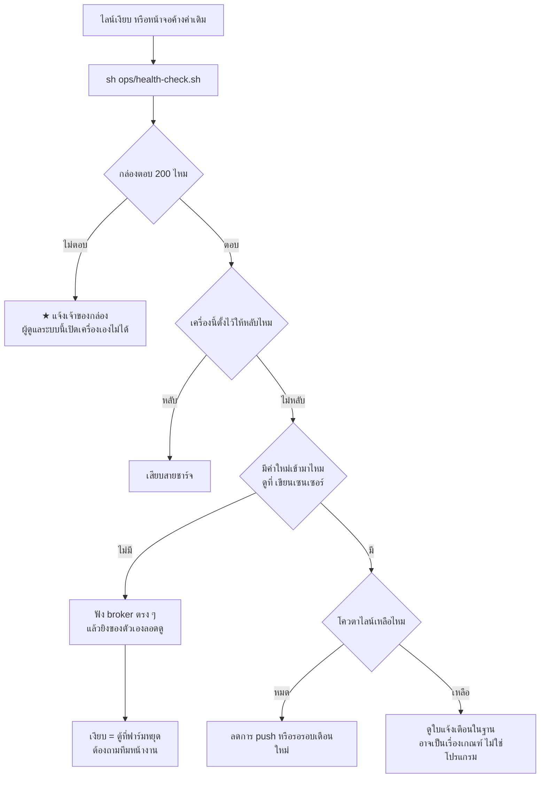

# 9 · ปัญหาที่พบและแนวทางแก้ไข

[← กลับสารบัญ](README.md)

> **หน้านี้สำคัญที่สุดในชุดเอกสาร** — ทุกข้อในนี้เคยเกิดจริงและเสียเวลาไปแล้ว
> อ่านก่อนลงมือแก้อะไร จะได้ไม่ต้องเจอซ้ำ

## 9.1 ★★ อาการร่วมของปัญหาในระบบนี้: **พังแล้วเงียบ**

ระบบนี้มีหลายชิ้นอยู่คนละเครื่อง และเกือบทุกครั้งที่พัง **หน้าจอยังดูปกติ**
ไม่มี error ขึ้น ไม่มีกล่องแดง มีแต่ตัวเลขที่ไม่ขยับ

➜ **วิธีจับคือดูที่ "เวลาอัปเดตล่าสุด" และ "จำนวนแถวต่อชั่วโมง" ไม่ใช่ดูที่ log**

## 9.2 ปัญหาที่แก้แล้ว — เก็บไว้เป็นบทเรียน

### ก. กล่องคุยด้วยไม่ได้ 7 วัน — ไลน์เงียบสนิท

| | |
| --- | --- |
| **อาการ** | ไม่มีแจ้งเตือนเข้าไลน์เลยตั้งแต่ 25 ก.ย.–2 ต.ค. 2569 |
| **สาเหตุ** | `tailscaled` กับโปรเซสของแอปบนกล่องตาย |
| **แก้** | เข้าไปเปิดใหม่ + ทำ **ตัวเฝ้าเครื่องหลักที่รันคนละเครื่อง** (T1.285) |
| **สถานะ** | ✅ แก้แล้ว |
| **บทเรียน** | ★ **ครั้งนั้นเครื่องรันอยู่ตลอด ที่ตายคือโปรแกรม** — "ไม่ตอบ" ≠ "เครื่องดับ" **อย่าด่วนสรุป** |

### ข. ★★ เสียโควตาไลน์ 177 ข้อความใน 2 วัน

| | |
| --- | --- |
| **อาการ** | LINE รายงานว่าใช้ไป 184/300 ทั้งที่ควรเป็น 7 |
| **สาเหตุ** | ใส่ค่าใหม่ `'activity'` ลงคอลัมน์ `line_notice.kind` **โดยไม่ดู CHECK constraint** · ตัวส่ง**ส่งออกสำเร็จก่อน** แล้วพังตอนบันทึก ตัวชี้จึงไม่ขยับ **รอบหน้าส่งซ้ำอีก วนทุก 30 วินาที** |
| **แก้** | เขียน migration เปิด constraint ให้รับค่าใหม่ **และ** เปลี่ยนเป็น **จองแถวก่อนส่ง** |
| **สถานะ** | ✅ แก้แล้ว 2 พ.ย. 2569 (T1.365) · แต่โควตาเดือน พ.ย. **เสียไปแล้วกู้ไม่ได้** |
| **บทเรียน** | ★★ **เพิ่มค่าใหม่ลงคอลัมน์ ต้องดู CHECK constraint ก่อนเสมอ** ★★ **จองแถวก่อนส่ง ไม่ใช่ส่งก่อนแล้วค่อยบันทึก** — จองไม่ได้ = ไม่ส่งเลย (เสียของรอบเดียว) ดีกว่าส่งแล้วจำไม่ได้ (ส่งซ้ำไม่รู้จบ) |

### ค. บันทึกผ่านไลน์ชนิดใหม่ใช้ไม่ได้ ทั้งที่เทสต์ผ่าน 872 ตัว

| | |
| --- | --- |
| **อาการ** | พิมพ์ "ทำความสะอาด" เข้าไลน์แล้วได้ `ชนิดบันทึกที่ไม่รู้จัก: clean` |
| **สาเหตุ** | `line/record.js` ถือรายชื่อชนิดบันทึก**ชุดที่สอง**ของตัวเอง |
| **แก้** | ลบรายชื่อซ้ำทิ้ง ให้ import จาก `barnlog/validate.js` ที่เดียว |
| **สถานะ** | ✅ แก้แล้ว 4 พ.ย. 2569 (T1.366) |
| **บทเรียน** | ★★ **เทสต์ผ่านครบไม่ได้แปลว่าใช้งานได้** — เทสต์ไม่เคยเรียกเส้นทางจริง **งานที่แตะของจริงต้องลองของจริงด้วย** |

### ง. ช่องติ๊กตั้งค่าแจ้งเตือน ติ๊กไม่ติดสักครั้ง

| | |
| --- | --- |
| **อาการ** | ติ๊กแล้วเด้งกลับ เซิร์ฟเวอร์ตอบ 400 |
| **สาเหตุ** | อ่านตัวแปรที่กำหนดค่าไว้**ข้างใน** ฟังก์ชันอัปเดตสถานะของ React ซึ่งทำงานทีหลัง จึงส่ง `null` ไป |
| **แก้** | เก็บค่าปัจจุบันไว้ใน `useRef` และเรียงคำขอเป็นคิว |
| **สถานะ** | ✅ แก้แล้ว 5 พ.ย. 2569 (T1.367) |

## 9.3 ★ ปัญหาที่ยังค้างอยู่ตอนส่งมอบ

### ก. ค่าเซนเซอร์ใหม่ยังไม่เข้ามา (ตั้งแต่ 5 พ.ย. 02:12)

**ตู้ควบคุมที่ฟาร์มหยุดส่ง** ตรวจแล้วว่าไม่ใช่ฝั่งรับของระบบนี้
เป็นเรื่องของทีมหน้างาน ต้องถามว่าตู้ยังมีไฟและยังต่อเน็ตอยู่ไหม

★★ **ค่าที่ขาดไประหว่างนี้ ดึงย้อนหลังกลับมาไม่ได้**
ระบบรับส่งที่ฟาร์มใช้ไม่เก็บประวัติให้ ขาดช่วงไหนคือหายช่วงนั้นถาวร

### ข. ใบแจ้งเตือนความชื้นเปิดค้างตั้งแต่ 12 ต.ค.

เกณฑ์ตั้งไว้ 70% แต่เล้าอยู่ที่ 88% ตลอด — **ไม่ใช่บั๊ก** ใบเปิดค้างแปลว่าเหตุยังอยู่จริง
★ **ต้องตกลงเกณฑ์กับคนหน้างานก่อน** แล้วจึงแก้ `alert_rule` ไม่ใช่แก้โปรแกรม

### ค. เซนเซอร์นอกเล้าไม่ได้วัดจริง

`SENSOR-OUT` ส่งค่าเดิมซ้ำทุกค่า — เป็นของทีมหน้างาน

### ง. กล้อง AI ออฟไลน์

เครื่อง Jetson ของทีม VISION SWINE ออฟไลน์ตั้งแต่ ~31 ต.ค. — หน้ากล้องจึงขึ้น
"ไม่มีสัญญาณ" **ตามที่ออกแบบ ไม่ใช่บั๊กของระบบนี้**

### จ. กล่องไม่มีตัวคุมโปรแกรม

`PID 1` เป็น `sleep infinity` — โปรแกรมตายแล้วไม่มีใครเปิดใหม่ให้ และ zombie ค้างถาวร 13 ตัว

## 9.4 ข้อจำกัดของระบบที่แก้ไม่ได้ด้วยโค้ด

| ข้อจำกัด | ผลที่ตามมา |
| --- | --- |
| **ค่าเซนเซอร์ที่ขาดช่วง ดึงย้อนหลังไม่ได้** | ระบบรับส่งที่ฟาร์มใช้ไม่เก็บประวัติให้ |
| **โควตาไลน์ 300 ข้อความ/เดือน นับต่อผู้รับ** | `reply` ไม่กิน แต่ `push`/`broadcast` กิน · **ห้ามเปลี่ยนการตอบแชทไปใช้ push เด็ดขาด** |
| **กล่องต่อออกไปหาเครื่องใน Tailscale ตรง ๆ ไม่ได้** | `tailscaled` เป็นโหมด userspace · `ping` ผ่านแต่ `curl` ไม่ผ่าน · ★ **ห้ามรีสตาร์ต tailscaled** เพราะ SSH คือทางเดียวที่เข้ากล่องได้ |
| **ไม่มีสิทธิ์เปิด/ปิด/ขยายดิสก์ของกล่อง** | ต้องแจ้งเจ้าของกล่อง |
| **เซนเซอร์และตู้ควบคุมที่ฟาร์มเป็นของทีมอื่น** | จะแก้ต้องคุยก่อน |
| **`HUB_KEY_SECRET` หายแล้วกู้ไม่ได้** | ต้องออกกุญแจใหม่ให้ทุกทีม |

## 9.5 ★ จุดที่ต้องระวังเป็นพิเศษเวลาพัฒนาเพิ่ม

| เรื่อง | ระวังอะไร |
| --- | --- |
| เพิ่มค่าใหม่ลงคอลัมน์ | **ดู CHECK constraint ก่อนเสมอ** |
| ส่งอะไรออกไปข้างนอก | **จองแถวก่อนส่ง** ไม่ใช่ส่งก่อนแล้วค่อยบันทึก |
| เพิ่มชนิดบันทึก / ชนิดข้อความ | ข้อมูลชุดเดียวกันอยู่หลายไฟล์ — ดู [ข้อ 6.4](06-สารบัญไฟล์.md) |
| ขึ้นเวอร์ชันกระดานเลย์เอาต์ | ★ เคยคูณค่า `y`/`h` สามเท่าทุกครั้งที่ขึ้นเวอร์ชัน **ต้องทดสอบกับ store เก่าจริงเสมอ** |
| แก้สีหรือฟอนต์ | ใช้ CSS variable จาก `tokens.css` เท่านั้น · มีเทสต์คุมโหมดสี 20 โหมด |
| เขียนปุ่มที่บันทึกข้อมูล | ต้องเช็ก `can()` ฝั่งหน้าเว็บ **และ** `requireRole` ฝั่งเซิร์ฟเวอร์ |
| สั่งอุปกรณ์จริง | ★ **ห้ามเดา topic/payload** เดาผิดแล้วพัดลมในโรงเรือนจริงหยุด |
| ตัวเฝ้าระวัง | **ห้ามให้มันแตะฐานข้อมูล** เพราะต้องพูดได้ตอนฐานล่ม |
| นับโควตาไลน์ | ★ `line_notice` **ไม่ใช่บัญชีครบ** มีอีก 3 ตัวที่ส่งโดยไม่บันทึก |

## 9.6 ไล่หาสาเหตุเมื่อระบบเงียบ

➜ คำสั่งทุกคำสั่งพร้อมคำอธิบายอยู่ใน **`docs/RUNBOOK.md`** (อยู่ในรีโปของโค้ด ไม่ได้อยู่ในชุดเอกสารนี้)
