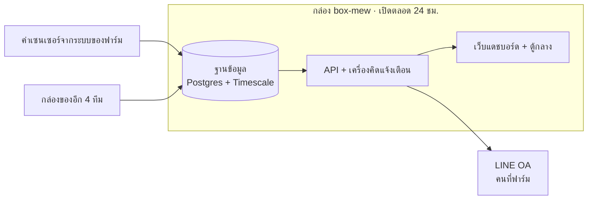

# ส่งมอบระบบ SWINE SYNC — เริ่มอ่านที่นี่

**ปรับปรุง 5 พ.ย. 2569 · งานล่าสุดที่ปิดคือ T1.367**

แดชบอร์ดติดตามฟาร์มสุกรของ CPF ที่กำแพงเพชร อ่านค่าจากเซนเซอร์ในโรงเรือนจริง
(อุณหภูมิ · ความชื้น · ลม · มิเตอร์ไฟ) แล้วแสดงบนเว็บ · **คิดแจ้งเตือนเองเมื่อค่าผิดเกณฑ์
แล้วส่งเข้า LINE OA ของฟาร์ม** · สรุปรายวันเข้าไลน์ · ตอบคำถามในไลน์ได้
· **บันทึกงานในเล้าผ่านไลน์ได้ 19 ชนิด** · **บันทึกว่าใครไปแก้อะไรในระบบ**

**คนใช้จริงคือคนที่ฟาร์ม** ผ่านไลน์เป็นหลัก และเปิดเว็บเมื่อต้องการดูละเอียด

---

## คำที่ใช้ทั้งเอกสาร

| คำ | หมายถึง |
| --- | --- |
| **กล่อง** | `box-mew` เครื่องที่เปิดตลอด 24 ชม. — **ของจริงรันอยู่ที่นี่** |

---

## อ่านทีละส่วน

| หน้า | มีอะไร |
| --- | --- |
| **[1 · หลังบ้าน](handover/01-หลังบ้าน.md)** | ฐานข้อมูล · API · เครื่องคิดแจ้งเตือน · ไลน์ — ทั้งหมดรันบนกล่อง |
| **[3 · หน้าบ้าน](handover/03-หน้าบ้าน.md)** | เว็บสองตัวคนละแอป — แดชบอร์ดกับตู้กลาง |
| **[4 · รับของทีมอื่นมาเชื่อมต่อ](handover/04-รับของทีมอื่น.md)** | 5 ทีมในโปรเจกต์ · สามทางที่รับเข้ามา · ขาออกที่ยังไปไม่ถึงตู้ |
| **[5 · การใช้งานและการตรวจ](handover/05-การใช้งานและการตรวจ.md)** | คำสั่งตรวจสุขภาพ · ผลล่าสุด · เจอปัญหาแล้วไล่ทางไหน |
| **[6 · สิทธิ์และความลับ](handover/06-สิทธิ์และความลับ.md)** | ใครเข้าอะไรได้ · ความลับอยู่ไหน · `HUB_KEY_SECRET` ที่หายแล้วกู้ไม่ได้ |
| **[7 · อะไรยังค้าง](handover/07-งานที่ยังค้าง.md)** | สองเรื่องที่ขวางการส่งมอบ · ของส่วนงานนี้ · ของทีมอื่น |
| **[8 · ถ้าจะแก้โค้ด](handover/08-แก้โค้ด.md)** | คำสั่งที่ใช้ · ★ ขั้นที่ลืมแล้วเปิดเว็บเจอของเก่า |
| **[9 · ลิงก์และ API](handover/09-ลิงก์และ-API.md)** | **อันไหนคืออะไร** — ทุกที่อยู่ ทุก `/api/…` ของส่วนงานนี้และของทีมอื่น · ชื่อที่ชนกันจนสับสน |

---

## สภาพระบบวันที่ปรับปรุง

**5 พ.ย. 2569 09:41** — โปรแกรมบนกล่องรันครบทุกตัว
· ดิสก์กล่องใช้ไป 23% เหลือ 1.4 TB · ฐานข้อมูลล่าสุดถึง migration `barn-log-more-types`

| ของจริงในฐาน | จำนวน |
| --- | --- |
| `sensor_reading` | 759,007 แถว |
| `power_reading` | 151,983 แถว |
| `barn_log` (ที่ยังไม่ถูกลบ) | 9 รายการ |
| `activity` (ใครทำอะไร) | 16 รายการ |
| แจ้งเตือนที่ยังเปิดค้าง | 3 ใบ |
| บัญชีไลน์ที่ผูกกับผู้ใช้แล้ว | 1 จาก 2 บัญชี |

### ★★ สองเรื่องที่ต้องรู้ก่อนเชื่อหน้าจอ

**1 · ค่าเซนเซอร์ที่เห็นบนหน้าจอ คือของที่เก็บทันเท่านั้น ไม่ใช่ทั้งหมดที่ฟาร์มส่งมา**
ค่าที่ขาดหายไปในบางช่วง **กู้ย้อนหลังไม่ได้** เพราะระบบรับส่งที่ฟาร์มใช้ไม่เก็บประวัติให้
➜ อ่านอายุของค่าล่าสุดบนหน้าจอเสมอ อย่าเพิ่งเชื่อว่าตัวเลขที่เห็นคือค่าปัจจุบัน

★ **ตู้ควบคุมที่ฟาร์มเงียบตั้งแต่ 5 พ.ย. 02:12** ค่าใหม่จึงยังไม่เข้ามา
เป็นเรื่องของทีมหน้างานที่ฟาร์ม ฝั่ง BOX-mew ทำอะไรไม่ได้

**2 · โควตาไลน์เดือนนี้เหลือน้อย — ใช้ไป 222 จาก 300**
`line_notice` บันทึกไว้แค่ 20 ใบ (แจ้งเตือน 15 · สรุปรายวัน 5) ส่วนที่เหลือหายไปกับบั๊ก
เมื่อ 2 พ.ย. ที่ตัวส่งวนส่งซ้ำ (แก้แล้ว T1.365) · **การส่ง "กิจกรรมของคน" เข้าไลน์จึงถูกปิดไว้**
(`activityLineKinds = []`) จนกว่าโควตาจะรีเซ็ตต้นเดือนธันวาคม

★★ **`line_notice` ไม่ใช่บัญชีครบของโควตา** อย่าเอาไปตอบว่าเดือนนี้ส่งไปกี่ใบ
มีตัวส่งอีกสามตัวที่ยิงตรง `api.line.me` โดยไม่บันทึกลงตารางนี้ — ตั้งใจให้เป็นอย่างนั้น
เพราะมันต้องพูดได้ตอนฐานข้อมูลล่ม: `watchdog/primary.js` · `watchdog/dataflow.js` · `line/health.js`
ตัวเฝ้าระวังที่อยู่นอกตัวนับนี้ส่งไปแล้ว **39 ใบ** (เดือน พ.ย. 5 ใบ) ไม่มีในตารางเลย
และการนับของ LINE เป็น **ต่อผู้รับ** การ broadcast หนึ่งครั้งจึงกินมากกว่าหนึ่งใบ
➜ **ถามโควตาจาก LINE โดยตรงเสมอ** `docker logs swine-bridge | grep "ส่งเข้า LINE"` ช่วยหาส่วนต่างได้

## สองเรื่องที่ขวางการส่งมอบ

1. **ก้อนความลับยังอยู่บนเครื่องของผู้ดูแลระบบเดิมเครื่องเดียว** — ยังไม่นับว่าส่งมอบ
2. **รีโปยังอยู่บัญชีส่วนตัว** — ต้องย้ายเข้า organization ของบริษัท

รายละเอียดทั้งสองข้ออยู่ใน [7 · อะไรยังค้าง](handover/07-งานที่ยังค้าง.md)

---

## เอกสารอื่นในชุดนี้

| ไฟล์ | ใช้เมื่อไร |
| --- | --- |
| **[ส่งมอบองค์กร/](../README.md)** | **เอกสารส่งมอบฉบับทางการ 12 หัวข้อตามแบบของบริษัท** — ภาพรวม · ติดตั้ง · คู่มือ GitHub · สถาปัตยกรรม · โครงสร้างไฟล์ · ปัญหาที่เจอ · งานค้าง |
| **`RUNBOOK.md`** (อยู่ในรีโปของโค้ด ไม่ได้อยู่ในชุดเอกสารนี้) | คู่มือลงมือจริง — คำสั่งทุกคำสั่ง · พังแล้วแก้ยังไง · ภาคผนวกที่มาของตัวเลข |
| **`TASKS.md`** (อยู่ในรีโปของโค้ด ไม่ได้อยู่ในชุดเอกสารนี้) | งานทุกงานพร้อมเหตุผล และ **อะไรที่ลองแล้วไม่ได้ผล** · ★ **เป็นบันทึกภายใน คงถ้อยคำเดิมไว้โดยตั้งใจ** ไม่ได้ใช้คำแทนบทบาทเหมือนชุดส่งมอบ |
| **`DESIGN.md`** (อยู่ในรีโปของโค้ด ไม่ได้อยู่ในชุดเอกสารนี้) | กติกาหน้าจอ — **อ่านก่อนแตะ UI** |
| **แผนย้ายระบบไปเครื่องบริษัท.md** (อยู่ในรีโปของโค้ด ไม่ได้อยู่ในชุดเอกสารนี้) | ย้ายเครื่องต้องทำอะไร + สี่จุดที่ลืมแล้วพังเงียบ |
| **สำรองไฟล์ความลับ.md** (อยู่ในรีโปของโค้ด ไม่ได้อยู่ในชุดเอกสารนี้) | ทำก้อนสำรองและตรวจว่ากู้ได้จริง |
