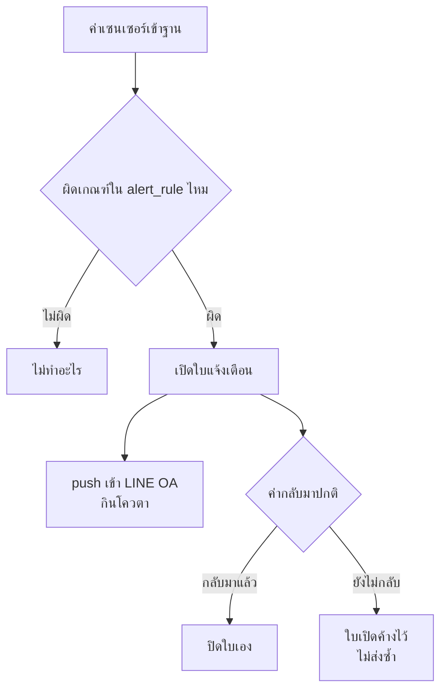

# 1 · หลังบ้าน — รันบนกล่อง

[← กลับหน้าสารบัญ](../HANDOVER.md)

ทุกอย่างในหน้านี้รันอยู่บน **กล่อง `box-mew`** ซึ่งเปิดตลอด 24 ชม.
**ฐานข้อมูลหลักมีที่นี่ที่เดียว** ไม่มีสำเนาที่อื่นที่ใช้งานอยู่

| ส่วน | ที่ต้องรู้ |
| --- | --- |
| ฐานข้อมูล | Postgres 16 + TimescaleDB · ชื่อฐาน `swinesync` |
| API | Express · `https://mew.plotnexuslab.com/api` · ตรวจสุขภาพที่ `/api/health` |
| เครื่องคิดแจ้งเตือน | เปิดใบแจ้งเตือนเมื่อค่าผิดเกณฑ์ และปิดใบเองเมื่อค่ากลับมาปกติ |
| ส่งไลน์ + บอทตอบไลน์ | `reply` ไม่กินโควตา · `push`/`broadcast` กิน (โควตา **300 ข้อความ/เดือน นับต่อผู้รับ**) |
| **บันทึกงานผ่านไลน์** | 19 ชนิด — ตาย ป่วย ขาดหาย ย้ายเข้า-ออก คลอด หย่านม ผสม ชั่ง ให้อาหาร ให้น้ำ ให้ยา วัคซีน อาหารคงเหลือ ทำความสะอาด ซ่อม ตรวจเล้า คนเข้าเล้า จดบันทึก · ห้าชนิดท้ายไม่ต้องบอกจำนวน พิมพ์เล่าต่อได้เลย |
| **ผูกบัญชีไลน์กับผู้ใช้** | หน้าจัดการผู้ใช้ → กล่อง "ผูกบัญชีไลน์กับผู้ใช้" (ผู้ดูแลระบบเท่านั้น) · ค่าตั้งต้นของทุกบัญชีคือ **อ่านได้ แต่เขียนไม่ได้** |
| **บันทึกว่าใครทำอะไร** | ตาราง `activity` — แก้เกณฑ์ · จัดการฟาร์ม/ผู้ใช้ · บันทึกงาน · สั่งอุปกรณ์ · ดูได้ที่หน้าการแจ้งเตือน |
| เข้าไปทำงาน | `ssh root@<ที่อยู่ของกล่อง>` · **กล่องไม่มี Docker** โค้ดขึ้นด้วย `rsync` |

## แจ้งเตือนทำงานยังไง



★ ใบที่เปิดค้างนาน ๆ **ไม่ใช่บั๊ก** — หมายความว่าเหตุยังอยู่จริง
ถ้าค้างนานผิดปกติให้สงสัย **เกณฑ์** ก่อนสงสัยโปรแกรม
(ตอนนี้มีใบความชื้นค้างมาตั้งแต่ 12 ต.ค. เพราะเกณฑ์ 70% ต่ำกว่าของจริงที่ 88% —
ดู [งานที่ยังค้าง](07-%E0%B8%87%E0%B8%B2%E0%B8%99%E0%B8%97%E0%B8%B5%E0%B9%88%E0%B8%A2%E0%B8%B1%E0%B8%87%E0%B8%84%E0%B9%89%E0%B8%B2%E0%B8%87.md))

## ★★ เพิ่มค่าใหม่ลงคอลัมน์ ต้องดู CHECK constraint ก่อนเสมอ

เสียโควตาไลน์ไป 177 ข้อความเพราะข้อนี้ (2 พ.ย. 2569) — ใส่ค่าใหม่ลง `line_notice.kind`
โดยไม่ดูว่าคอลัมน์จำกัดค่าไว้ ตัวส่ง**ส่งออกไปสำเร็จก่อน** แล้วค่อยพังตอนบันทึก
ตัวชี้จึงไม่ขยับ **รอบหน้าส่งซ้ำอีก** วนทุก 30 วินาที

สองตารางที่มี constraint แบบนี้และต้องระวัง

| ตาราง | คอลัมน์ | เพิ่มค่าใหม่ต้องแก้ที่ไหนอีก |
| --- | --- | --- |
| `line_notice` | `kind` | `line/notifier.js` |
| `barn_log` | `type` | `barnlog/validate.js` · `src/lib/barnLogTypes.js` · `line/intent.js` · `line/recordText.js` |

★ และกติกาที่ใช้ได้ทุกที่: **จองแถวก่อนส่ง ไม่ใช่ส่งก่อนแล้วค่อยบันทึก**
จองไม่สำเร็จ = ไม่ส่งเลย (เสียของรอบเดียว) · ส่งแล้วจำไม่ได้ = ส่งซ้ำไม่รู้จบ

## ★★ กล่องไม่มีตัวคุมโปรแกรม — ตายแล้วไม่มีใครเปิดใหม่ให้

ตรวจจริง 5 พ.ย. 2569: **`PID 1` ของกล่องคือ `sleep infinity`** ไม่ใช่ systemd
โปรแกรมบนกล่องถูกสั่งเปิดด้วยมือทั้งหมด และไม่มีใครดูแลต่อ

ตามมาสองเรื่อง

| เรื่อง | ผลที่เกิด |
| --- | --- |
| โปรแกรมตาย | **ไม่มีอะไรเปิดใหม่ให้** ต้องเข้าไปเปิดเอง |
| ไม่มีใครเก็บศพลูก | process ที่ตายค้างเป็น **zombie ถาวร** · 5 พ.ย. นับได้ 13 ตัว รวม `psql` ที่เพิ่งรันเสร็จ |

★ zombie ไม่กินซีพียูหรือแรม แต่กินช่องตารางโปรเซส และทำให้ `ps` อ่านยาก
**อย่าตกใจว่าโปรแกรมรันซ้ำหลายตัว** — ดูคอลัมน์ `stat` ถ้าขึ้น `Z` คือศพ ไม่ใช่ตัวที่รันอยู่

```bash
ssh root@<ที่อยู่ของกล่อง> 'ps -eo pid,ppid,stat,etime,args | grep -v " Z"'
```

➜ งานที่ควรทำ: ใส่ตัวคุมโปรแกรมให้กล่อง (systemd unit หรืออย่างน้อย `--restart=always`)
ตอนย้ายไปเครื่องของบริษัท — อยู่ใน [งานที่ยังค้าง](07-%E0%B8%87%E0%B8%B2%E0%B8%99%E0%B8%97%E0%B8%B5%E0%B9%88%E0%B8%A2%E0%B8%B1%E0%B8%87%E0%B8%84%E0%B9%89%E0%B8%B2%E0%B8%87.md)

## ★ ตัวส่งไลน์มีสี่ตัว แต่บันทึกลงตารางแค่ตัวเดียว

| ตัวส่ง | บันทึกลง `line_notice` |
| --- | --- |
| `line/notifier.js` — แจ้งเตือน · สรุปรายวัน · กิจกรรมของคน | ✓ จองแถวก่อนส่ง |
| `watchdog/primary.js` — เฝ้ากล่อง | ✗ |
| `watchdog/dataflow.js` — เฝ้าการไหลของข้อมูล | ✗ |
| `line/health.js` — เฝ้าช่องทางไลน์ | ✗ |

สามตัวล่าง **ตั้งใจไม่แตะฐาน** เพราะต้องพูดได้ตอนฐานล่ม ซึ่งเป็นตอนที่ต้องการมันที่สุด
➜ แต่แปลว่า **`select count(*) from line_notice` ตอบโควตาที่ใช้ไปไม่ได้**
ของจริงต้องถาม LINE โดยตรง

## สองข้อห้าม

★ **ห้ามรันเครื่องคิดแจ้งเตือนสองชุดพร้อมกันบนฐานข้อมูลเดียวกัน**
จะเปิดใบแจ้งเตือนซ้ำ และคนที่ฟาร์มจะได้ข้อความไลน์สองชุด

★ **หลังบ้านของตัวกล่องเอง (เปิด/ปิด/รีสตาร์ตเครื่อง) ไม่ใช่สิทธิ์ของผู้ดูแลระบบนี้** — ต้องแจ้งเจ้าของกล่อง
ใส่ชื่อ/ช่องทางติดต่อไว้ที่ `PRIMARY_OWNER` ใน `.env` แล้วข้อความแจ้งเตือนจะบอกชื่อนั้นให้เลย

➜ คำสั่งทุกคำสั่งสำหรับทำงานกับกล่อง อยู่ใน **`RUNBOOK.md`** (อยู่ในรีโปของโค้ด ไม่ได้อยู่ในชุดเอกสารนี้)
· `/api/…` แต่ละหมวดคืออะไรและใครผ่านด่านไหนได้ ดู [ลิงก์และ API](09-%E0%B8%A5%E0%B8%B4%E0%B8%87%E0%B8%81%E0%B9%8C%E0%B9%81%E0%B8%A5%E0%B8%B0-API.md)
