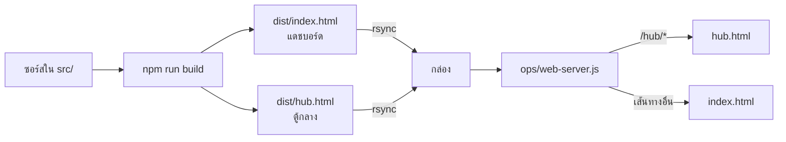

# 3 · หน้าบ้าน — เว็บสองตัว คนละแอป

[← กลับหน้าสารบัญ](../HANDOVER.md)

| เว็บ | ใครใช้ | ที่อยู่ |
| --- | --- | --- |
| แดชบอร์ดฟาร์ม | คนที่ฟาร์ม · ผู้บริหาร | `https://mew.plotnexuslab.com` |
| **ตู้กลาง** (T1.347) | ผู้ดูแลระบบเท่านั้น | `https://mew.plotnexuslab.com/hub` |

★ **`npm run build` สร้างออกมาสองแอป** คนที่แยกให้คือ `ops/web-server.js` บนกล่อง
แก้ตัวนั้นพลาดแล้วเปิด `/hub` จะได้หน้า "ไม่พบหน้านี้" ของแดชบอร์ด **ทั้งที่ที่อยู่ถูก** — หาสาเหตุยากมาก

★ **คนที่เปิด `/hub` ไม่โหลดโค้ดของแดชบอร์ดแม้แต่บรรทัดเดียว** เป็นคนละแอปจริง ๆ
ผู้ใช้สั่งให้แยกเพราะกดเข้าตู้กลางแล้วไม่ควรเจอแดชบอร์ดของฟาร์ม

★ **ชื่อย่อกล่องในตู้กลางเปลี่ยนไม่ได้** เพราะฝังอยู่ในกุญแจที่ส่งให้ทีมอื่นไปแล้ว
เปลี่ยนแล้วกุญแจเดิมจะหาแถวไม่เจอ → **ข้อมูลหยุดไหลเงียบ ๆ**

➜ ตู้กลางรับของทีมอื่นเข้ามาอย่างไร ดู [รับของทีมอื่นมาเชื่อมต่อ](04-%E0%B8%A3%E0%B8%B1%E0%B8%9A%E0%B8%82%E0%B8%AD%E0%B8%87%E0%B8%97%E0%B8%B5%E0%B8%A1%E0%B8%AD%E0%B8%B7%E0%B9%88%E0%B8%99.md)
· ขั้นตอนตรวจหลังขึ้นของจริง ดู **ตรวจหลังขึ้นตู้กลาง.md** (อยู่ในรีโปของโค้ด ไม่ได้อยู่ในชุดเอกสารนี้)
· กติกาหน้าจออยู่ใน **`DESIGN.md`** (อยู่ในรีโปของโค้ด ไม่ได้อยู่ในชุดเอกสารนี้) — **อ่านก่อนแตะ UI**
· ★ ที่อยู่ไหนคืออะไร และทำไมปุ่มในการ์ดไลน์ไม่ได้พามาที่ `mew` ดู [ลิงก์และ API](09-%E0%B8%A5%E0%B8%B4%E0%B8%87%E0%B8%81%E0%B9%8C%E0%B9%81%E0%B8%A5%E0%B8%B0-API.md)
