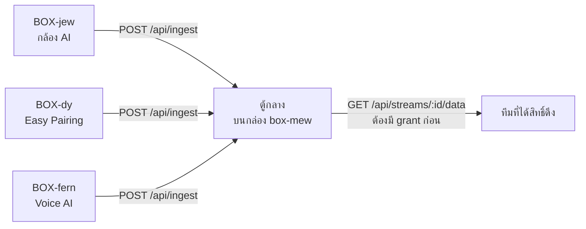

# 4 · รับของทีมอื่นมาเชื่อมต่อ

[← กลับหน้าสารบัญ](../HANDOVER.md)

โปรเจกต์นี้มี **5 ทีม** ทำคนละส่วนและรันคนละเครื่อง แดชบอร์ดนี้เป็นตัวรวม
จึงรับของคนอื่นเข้ามา **สองทางที่ไม่เหมือนกันเลย** อย่าสลับกัน



| ทาง | ใครส่ง | เข้ามาที่ไหน | สถานะ 30 ต.ค. 2569 |
| --- | --- | --- | --- |
| **ตู้กลาง** `POST /api/ingest` | 4 ทีม — `dy` `fern` `jew` `muey` | ตารางของตู้กลางบนกล่อง | `fern` ส่งของจริงมา 20 รายการ · `dy` ยิงทุก 60 วิ (ยังเป็นชุดทดสอบ) · `jew` `muey` ได้กุญแจ 27 ต.ค. แล้วแต่ยังไม่ส่ง |
| **เรียก API ของเขา** | AI ของฟาร์ม · Voice AI · Open-Meteo | หลังบ้านของระบบนี้เรียกต่อให้ | AI ตอบได้แล้ว · Voice ยังติด SSO |

---

## 4.1 ค่าเซนเซอร์ของฟาร์ม

**ค่าเซนเซอร์ในโรงเรือนมาจากระบบของฟาร์มเอง และเข้ามาอยู่ในฐานข้อมูลบนกล่องแล้ว**
ตารางที่ใช้คือ `sensor_reading` กับ `power_reading` — หน้าจอ เครื่องคิดแจ้งเตือน
และสรุปรายวัน อ่านจากสองตารางนี้ทั้งหมด

★ **ตัวเซนเซอร์และตู้ควบคุมที่ฟาร์มเป็นของทีมหน้างาน ไม่ใช่ของส่วนงานนี้**
ค่าใหม่ไม่เข้าเมื่อไรเป็นเรื่องที่ต้องถามทีมนั้น
และ **ค่าที่ขาดหายไปในช่วงหนึ่ง ดึงย้อนหลังกลับมาไม่ได้**

---

## 4.2 ขาเข้าทางตู้กลาง — ของทีมอื่นทั้งหมด

```
POST https://mew.plotnexuslab.com/api/ingest
Authorization: Bearer <กุญแจประจำกล่อง>
Content-Type: application/json
```

- สามชนิด: `reading` (ต้องมี `value` ตัวเลข) · `event` (ต้องมี `payload`) · `file` (ต้องมี `url`)
- ★ **ไฟล์เก็บแค่ที่อยู่ ไม่เก็บตัวไฟล์** — วิดีโอต่อเนื่อง 21 กล้องกินราว 13 TB/เดือน ซึ่งเต็มใน 3 วัน
- ★ **ชื่อชุดข้อมูลทีมอื่นตั้งเองได้** ตู้กลางขึ้นทะเบียนให้เองตอนเห็นครั้งแรก ไม่ต้องรอผู้ดูแลเปิดให้
- ★ **ผิดรายการเดียวคือไม่เข้าทั้งก้อน** (ตอบกลับว่ารายการที่เท่าไรผิดเพราะอะไร) · ครั้งละไม่เกิน 500 รายการ
- ★ ส่ง `at` ซ้ำเวลาเดิม = **ทับค่าเดิม** ยิงซ้ำหลังเน็ตหลุดได้ปลอดภัย · ไม่ส่ง `at` = ใช้เวลาที่มาถึง
- ★ **สิทธิ์ดึงออกเป็นศูนย์โดยค่าตั้งต้น** ต้องมีแถวใน `stream_grant` ก่อน · ชุดที่ดึงไม่ได้ตอบ
  **404 เหมือนชุดที่ไม่มีจริง ไม่ใช่ 403** เพื่อไม่ให้ไล่เดาได้ว่าทีมอื่นมีชุดอะไร
- กุญแจ: ออก/เพิกถอน/ดูย้อนหลังที่หน้า `/hub` · ⚠ **ส่งกุญแจตัวต่อตัว ห้ามลงกลุ่มรวม**

➜ สเปกเต็มของตู้กลางพร้อมตัวอย่างก้อนข้อมูล → [ส่งมอบองค์กร ข้อ 7.3](../../07-เชื่อมต่อกับแต่ละทีม.md)

---

## 4.3 ของทีมอื่นที่ระบบนี้เป็นฝ่ายไปเรียก

| ของใคร | ที่ต้องรู้ |
| --- | --- |
| **AI ของฟาร์ม** (`CPF_AI_URL`) | กุญแจอยู่ฝั่งเซิร์ฟเวอร์เท่านั้น ห้ามย้ายมาฝั่งหน้าเว็บ · ★ **ผู้ใช้ใหม่ต้องให้ทีมนั้นลงทะเบียนก่อน ไม่งั้นได้ 401** · แปลงชื่อผู้ใช้ที่ `CPF_AI_USER_MAP` |
| **Voice AI** (`farmy-web.onrender.com`) | ฝังในหน้า `/dashboard/voice` · ★ โฮสต์ฟรีหลับเมื่อไม่มีคนใช้ ครั้งแรกของวันรอ 30–60 วิ **ไม่ใช่ลิงก์เสีย** · ยังไม่มี SSO จึงถามเรื่องในฟาร์มจากกรอบเต็มจอไม่ได้ |
| **Open-Meteo** | พยากรณ์อากาศฟรี ไม่ต้องมีกุญแจ · ★ เป็นค่า**ทำนาย** ห้ามเอาไปปนกับค่าที่เสาอากาศวัดได้ ต่างกันหลายองศาได้โดยที่ทั้งคู่ไม่ได้พัง |
| **PlotNexus** | ถูกถอนสิทธิ์ 403 ตั้งแต่ 11 ก.ย. 2569 · ปิดการเรียกไว้ทั้งสองฝั่งแล้ว ไม่ขวางงาน |

---

## 4.4 ขาออก — สั่งอุปกรณ์ ยังไปไม่ถึงตู้


★ **ตั้งใจไม่เดา topic เอง** — เดาผิดแล้วโชคร้ายคือพัดลมในโรงเรือนจริงหยุด

### ★ เจ็ดอย่างที่ยังต้องขอจากทีม PLC

เนื้อหานี้เคยอยู่ในจดหมายขอสิทธิ์แยกไฟล์ · ย้ายมาไว้ที่นี่เพื่อให้คนรับช่วงเห็นในที่เดียว

| # | สิ่งที่ขาด | ทำไมต้องมี |
| --- | --- | --- |
| 1 | **topic ขาออกของแต่ละอุปกรณ์** — พัดลม `FAN 1`–`FAN 5` · ปั๊มน้ำดื่ม `P1` · ปั๊มระบายน้ำ `P2` · ปั๊มม่านน้ำ `P3` | ไม่รู้ว่าจะ publish ไปที่ไหน |
| 2 | **รูปข้อมูลที่ตู้รับ** | ส่งผิดรูป ตู้ไม่ทำตาม หรือทำผิดอย่าง |
| 3 | **ช่องทางและบัญชีที่ใช้ส่งคำสั่งได้** | ★ คำสั่งต้องไม่วิ่งผ่านช่องทางสาธารณะ |
| 4 | **รายชื่ออุปกรณ์จริงของโรงเรือน A1** | รหัสที่เว็บใช้ต้องตรงกับของจริง |
| 5 | **ช่วงค่าที่ยอมรับและคำสั่งที่รองรับ** — ตั้งไว้ `on` `off` `speed` `auto` · พัดลม 20–60 Hz · ปั๊มปรับรอบไม่ได้ | ขอให้ยืนยันหรือแก้ |
| 6 | **ช่องทางที่ตู้ตอบกลับว่าทำตามแล้ว** | ★★ **ข้อที่ขาดมากที่สุด** — ไม่มีข้อนี้ หน้าจอจะบอกได้แค่ "ส่งออกไปแล้ว" ไม่ใช่ "พัดลมหมุนแล้ว" |
| 7 | **ข้อจำกัดฝั่งตู้** เช่น สั่งถี่ได้แค่ไหน สั่งพร้อมกันได้กี่ตัว | กันการสั่งรัวจนตู้รับไม่ไหว |

★ **ช่องทางนี้ไม่ใช่ปุ่มหยุดฉุกเฉิน** — ของจริงต้องหยุดที่หน้าตู้เสมอ

➜ ที่อยู่แต่ละอันคืออะไร ของใคร ตอนนี้ตอบอะไร → [ลิงก์และ API](09-ลิงก์และ-API.md)
