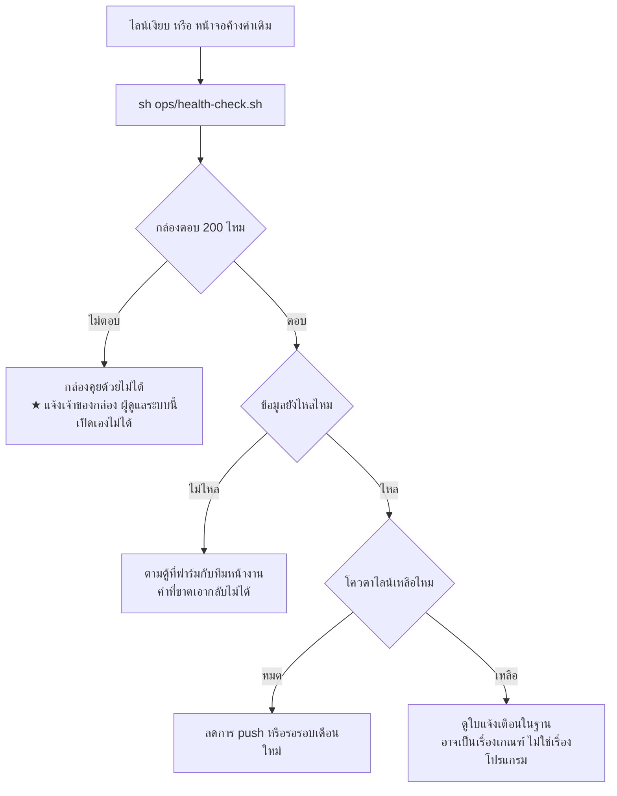

# 5 · การใช้งานและการตรวจ

[← กลับหน้าสารบัญ](../HANDOVER.md)

**คนใช้จริงคือคนที่ฟาร์ม** ผ่านไลน์เป็นหลัก และเปิดเว็บเมื่อต้องการดูละเอียด
ดังนั้น "ไลน์เงียบ" คืออาการที่ต้องรีบที่สุด และหน้าตามันเหมือน "ทุกอย่างปกติ"

## ตรวจด้วยคำสั่งเดียว

```bash
sh ops/health-check.sh      # อ่านอย่างเดียว ปลอดภัย รันซ้ำได้ตลอด
```

ตรวจว่ากล่องตอบไหม · บริการครบไหม · ข้อมูลยังเข้าไหม · ดิสก์เหลือเท่าไร ·
ตัวเฝ้าระวังเปิดส่งไลน์อยู่ไหม — บรรทัด `[ !! ]` คือเรื่องที่ต้องไปดู พร้อมบอกว่าต้องทำอะไร

## ผลตรวจ 5 พ.ย. 2569 09:41

| เรื่อง | ที่วัดได้ |
| --- | --- |
| กล่อง | โปรแกรมรันครบทุกตัว — API · เครื่องคิดแจ้งเตือน · เว็บ |
| ข้อมูลเซนเซอร์ | `sensor_reading` 759,007 แถว · `power_reading` 151,983 แถว |
| ★★ **ค่าใหม่** | **ยังไม่เข้ามาตั้งแต่ 5 พ.ย. 02:12** — ตู้ควบคุมที่ฟาร์มเงียบ เป็นเรื่องของทีมหน้างาน |
| ไลน์ | **ใช้ไป 222 จากโควตา 300** · `line_notice` บันทึกแค่ 20 ใบ ส่วนต่างคือบั๊กเมื่อ 2 พ.ย. (แก้แล้ว) |
| แจ้งเตือน | เปิดค้าง 3 ใบ — ยังมีเหตุจริง ไม่ใช่ใบที่ลืมปิด |
| บันทึกงานในเล้า | 9 รายการที่ยังไม่ถูกลบ |
| ใครทำอะไรในระบบ | 16 รายการ · **การส่งเข้าไลน์ปิดอยู่** จนกว่าโควตาจะรีเซ็ต ธ.ค. |
| บัญชีไลน์ | ผูกกับผู้ใช้แล้ว 1 จาก 2 บัญชี |
| ดิสก์กล่อง | ใช้ไป 23% เหลือ 1.4 TB — สบาย |
| ★ zombie บนกล่อง | 13 ตัว · `PID 1` เป็น `sleep infinity` จึงไม่มีใครเก็บ ([ข้อ 1](01-%E0%B8%AB%E0%B8%A5%E0%B8%B1%E0%B8%87%E0%B8%9A%E0%B9%89%E0%B8%B2%E0%B8%99.md)) |

★ **ตัวเลขไลน์สองที่ไม่ตรงกันเป็นเรื่องปกติ** — LINE นับ**ต่อผู้รับ** การ broadcast
หนึ่งครั้งจึงกินมากกว่าหนึ่งใบ และ **มีตัวส่งอีกสามตัวที่ไม่บันทึกลง `line_notice` เลย**
(ตัวเฝ้าระวังสามตัว ตั้งใจไม่แตะฐาน — ดู [ข้อ 1](01-%E0%B8%AB%E0%B8%A5%E0%B8%B1%E0%B8%87%E0%B8%9A%E0%B9%89%E0%B8%B2%E0%B8%99.md))
เวลาจะรู้ของจริงให้ถามโควตาจาก LINE โดยตรง อย่าอ่านจากตารางในฐานนี้อย่างเดียว

## ค่าเซนเซอร์ไม่เข้า ทำยังไง

**ค่าเซนเซอร์มาจากระบบของฟาร์มเอง** ฝั่งนี้เป็นปลายทางที่รับมาเก็บเท่านั้น
ค่าใหม่ไม่เข้าเมื่อไร ให้ดูอายุของค่าล่าสุดบนหน้าจอก่อน แล้ว**ถามทีมหน้างานที่ฟาร์ม**
★ **ค่าที่ขาดไปในช่วงหนึ่ง ดึงย้อนหลังกลับมาไม่ได้**

## เจอปัญหาแล้วไล่ทางนี้



## จุดที่พังจริงมาแล้ว

| เรื่อง | อาการ | ที่ต้องรู้ |
| --- | --- | --- |
| กล่องคุยด้วยไม่ได้ | ไลน์เงียบสนิท | เกิดจริง 25 ก.ย.–2 ต.ค. 2569 · ★ ครั้งนั้น**เครื่องรันอยู่ตลอด** ที่ตายคือ tailscaled กับโปรเซสของแอป **อย่าด่วนสรุปว่าเครื่องดับ** |
| ค่าเซนเซอร์ไม่เข้า | หน้าจอค้างค่าเดิม | เกิดจริง 29 ก.ย. 2569 หยุด 34 ชม. · ★ ค่าที่ขาด **เอากลับมาไม่ได้** · เป็นเรื่องของทีมหน้างาน |
| โควตาไลน์หมด | ส่งแจ้งเตือนไม่ออก | 300 ข้อความ/เดือน · `push` กินโควตา `reply` ไม่กิน |
