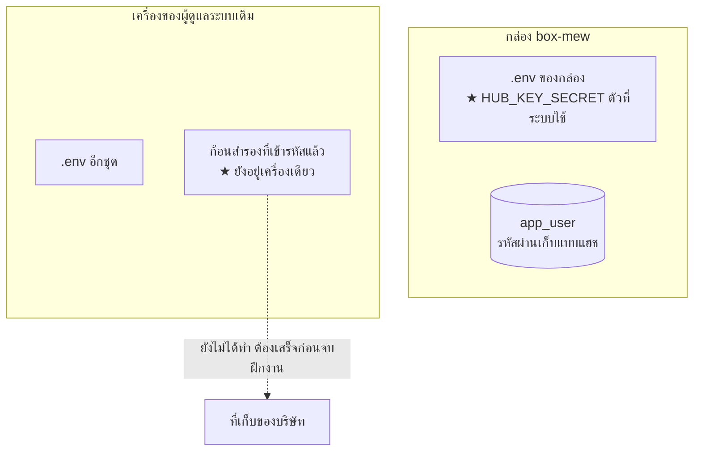

# 6 · สิทธิ์และความลับ

[← กลับหน้าสารบัญ](../HANDOVER.md)

## ใครมีสิทธิ์ทำอะไร

| ของ | ใครเข้าได้ |
| --- | --- |
| โค้ด · ฐานข้อมูล · เว็บ | **ทีมแดชบอร์ด (ส่วนงานนี้)** |
| ตัวกล่อง (เปิด/ปิด/รีสตาร์ตเครื่อง) | **ไม่ใช่ส่วนงานนี้** — เจ้าของกล่อง |
| ตู้ควบคุม/เกตเวย์ที่ฟาร์ม | ทีมหน้างาน |
| กุญแจ PlotNexus | ทีม PlotNexus |

**กล่องดับ = ผู้ดูแลระบบนี้เปิดเองไม่ได้** ทำได้แค่รู้ให้เร็วแล้วแจ้งคนที่มีสิทธิ์
— นี่คือเหตุผลที่ตัวเฝ้าระวังมีอยู่

## ความลับอยู่ที่ไหน

**ไม่มีค่าความลับใดอยู่ใน repo** (ตรวจทุก blob ที่เข้าถึงได้ 1,914 ก้อนแล้ว 28 ต.ค. 2569 —
รายละเอียดอยู่ใน **RUNBOOK ภาคผนวก ข.** (อยู่ในรีโปของโค้ด ไม่ได้อยู่ในชุดเอกสารนี้))

| อะไร | อยู่ที่ไหน |
| --- | --- |
| รหัสฐานข้อมูล · token ไลน์ · บัญชี Farmy | `.env` ที่ราก repo — **คนละชุดบนกล่องกับบนเครื่องที่ใช้พัฒนา** |
| **`HUB_KEY_SECRET`** ตัวถอดกุญแจของตู้กลาง | `.env` **บนกล่อง** คือตัวที่ระบบใช้ |
| บัญชีผู้ใช้ของแดชบอร์ด | ตาราง `app_user` · รหัสผ่านเก็บแบบแฮช |

## ★ `HUB_KEY_SECRET` — หายแล้วกู้คืนไม่ได้

ไม่อยู่ใน git และ **ไม่อยู่ในไฟล์สำรองฐานข้อมูล**

| ถ้าหาย | เกิดอะไร |
| --- | --- |
| ระบบรับข้อมูลเข้า | **ยังทำงานปกติ** — ตรวจกุญแจด้วยแฮช ไม่ได้ใช้ตัวนี้ |
| ปุ่ม "ดูกุญแจ" ในหน้า `/hub` | **ใช้ไม่ได้ถาวร** ต้องออกกุญแจใหม่ทุกกล่องแล้วไล่แจ้งทุกทีมให้เปลี่ยนตาม |

⚠ **ห้ามเก็บไว้ในโฟลเดอร์เดียวกับไฟล์สำรองฐานข้อมูล** — เหตุผลที่เลือกเข้ารหัสคือ
"ได้ไฟล์สำรองไปอย่างเดียวต้องใช้ไม่ได้" วางคู่กันแล้วการเข้ารหัสไม่มีความหมายเลย

⚠ เปลี่ยนค่านี้ต้องถอดด้วยตัวเก่าแล้วเข้ารหัสใหม่ในคราวเดียว
**แก้ `.env` เฉย ๆ แล้วรีสตาร์ต = ทำของหาย**

## ก้อนสำรองความลับ

ทำแล้ว 28 ต.ค. 2569 — `~/swine-ความลับ-2569-10-28.tar.gz.enc` ถอดทดสอบแล้วครบ 5 ไฟล์
วิธีทำและวิธีตรวจว่ากู้ได้จริงอยู่ใน **สำรองไฟล์ความลับ.md** (อยู่ในรีโปของโค้ด ไม่ได้อยู่ในชุดเอกสารนี้)

★ **ยังอยู่บนเครื่องของผู้ดูแลระบบเดิมเครื่องเดียว จึงยังไม่นับว่าสำรองและยังไม่นับว่าส่งมอบ**
ทางที่ได้ทั้งสองอย่าง: **วางก้อนที่เข้ารหัสไว้ในที่เก็บของแผนก แล้วถือรหัสไว้คนเดียว**
บริษัทมีของสำรองจริง แต่ยังเปิดไม่ได้จนกว่าจะส่งรหัสให้
