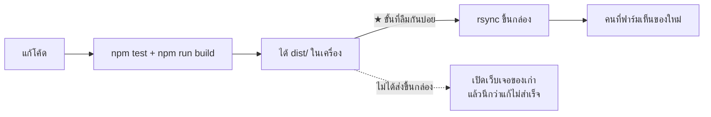

# 8 · ถ้าจะแก้โค้ด

[← กลับหน้าสารบัญ](../HANDOVER.md)

```bash
npm install                 # ครั้งแรกครั้งเดียว
npm run dev                 # เปิดหน้าเว็บสำหรับพัฒนา
npm test                    # ต้องผ่านทั้งหมดก่อน commit
npm run lint
npm run build
```

## ★ build เสร็จแล้วยังไม่ขึ้นของจริง



เว็บที่คนที่ฟาร์มใช้อยู่บนกล่อง ต้องส่งไฟล์ขึ้นไปอีกขั้น
วิธีเต็มพร้อมวิธีถอยกลับอยู่ใน **`RUNBOOK.md`** (อยู่ในรีโปของโค้ด ไม่ได้อยู่ในชุดเอกสารนี้) หัวข้อ **เอาโค้ดที่แก้แล้วขึ้นของจริง**
(ลืมขั้นนี้แล้วเสียเวลาไล่หาสาเหตุมาแล้วจริง 28 ต.ค. 2569)

★★ **ขั้นสลับให้ใช้ `sh ops/deploy-swap.sh` เท่านั้น ห้ามพิมพ์ `mv` เอง**
คำสั่ง `mv` สองขั้นแบบเดิมถูกกดซ้ำเมื่อ 6 พ.ย. 2569 ขั้นแรกย้ายของที่ใช้อยู่ออกสำเร็จ
ขั้นสองล้มเพราะของใหม่ถูกใช้ไปแล้ว **เว็บจึงตอบ 404**
สคริปต์ตรวจให้เองก่อนแตะของเดิม กดซ้ำกี่ครั้งก็ไม่พัง

## สามเรื่องที่ต้องรู้ก่อนลงมือ

- ไฟล์ `dist-old-*` บนกล่อง **คือทางถอยกลับ ไม่ใช่ขยะ** อย่าไล่ลบ
- กติกาหน้าจออยู่ใน **`DESIGN.md`** (อยู่ในรีโปของโค้ด ไม่ได้อยู่ในชุดเอกสารนี้) — **อ่านก่อนแตะ UI**
- **เครือข่าย CPF ทำ TLS interception** — `npm install` ในออฟฟิศล้มบ่อย ให้ลงของใหม่จากเน็ตอื่น
