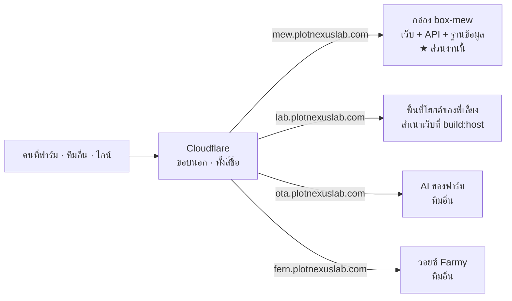

# 9 · ลิงก์และ API — อันไหนคืออะไร

[← กลับหน้าสารบัญ](../HANDOVER.md)

ชื่อโดเมนในโปรเจกต์นี้ลงท้าย `plotnexuslab.com` เหมือนกันหมด **แต่เป็นของคนละเจ้าของ
และคนละหน้าที่** หน้านี้คือพจนานุกรมลิงก์ เปิดดูเวลาเจอที่อยู่แปลก ๆ ในโค้ดหรือใน `.env`

## 9.1 ชื่อไหนไปถึงเครื่องไหน

★ **`mew` เท่านั้นที่เป็นเครื่องของส่วนงานนี้** อีกสามชื่อเป็นแค่ปลายทางที่ระบบนี้ไปเรียก
ชื่อคล้ายกันเพราะใช้โดเมนของพี่เลี้ยงร่วมกัน **ไม่ได้แปลว่าเป็นระบบเดียวกัน**

★ **Cloudflare ตอบ ≠ ระบบทำงาน** ถ้าได้ `503` แปลว่าขอบนอกยังยืนรับอยู่แต่เครื่องข้างหลังไม่ตอบ
(เจอจริงช่วง 25 ก.ย.–2 ต.ค. 2569)

## 9.2 ลิงก์ของส่วนงานนี้

| ลิงก์ | นี่คืออะไร |
| --- | --- |
| `https://mew.plotnexuslab.com` | **เว็บแดชบอร์ดของจริง** คนที่ฟาร์มเปิดอันนี้ |
| `https://mew.plotnexuslab.com/hub` | **ตู้กลาง** — คนละแอปกับข้างบน ผู้ดูแลระบบเท่านั้น |
| `https://mew.plotnexuslab.com/api` | **API ของส่วนงานนี้** ทุกเส้นทางอยู่ใต้นี้ |
| `https://mew.plotnexuslab.com/api/health` | ★ **ปุ่มจับชีพจร** — `200` = ระบบเดิน · บอกจำนวนแถวและเวลาค่าล่าสุดมาด้วย |
| `https://mew.plotnexuslab.com/api/ingest` | **ปากทางให้ทีมอื่นส่งข้อมูลเข้า** (ดู [รับของทีมอื่น](04-%E0%B8%A3%E0%B8%B1%E0%B8%9A%E0%B8%82%E0%B8%AD%E0%B8%87%E0%B8%97%E0%B8%B5%E0%B8%A1%E0%B8%AD%E0%B8%B7%E0%B9%88%E0%B8%99.md)) |
| `https://mew.plotnexuslab.com/api/line/webhook` | ★ **ที่อยู่ที่ผูกไว้ในคอนโซล LINE** — ย้ายเครื่องแล้วลืมแก้ที่นั่น บอทจะเงียบทันที |
| `https://lab.plotnexuslab.com/p/mew/dashboard/` | **สำเนาเว็บบนพื้นที่โฮสต์ของพี่เลี้ยง** — ★ **ปุ่มในการ์ดไลน์พาไปที่นี่ ไม่ใช่ `mew`** (ค่า `DASHBOARD_URL`) |
| `ssh root@<ที่อยู่ของกล่อง>` | ทางเข้าไปทำงานบนกล่อง ผ่าน Tailscale · ไม่ใช่เว็บ |

★ สำเนาที่ `lab.…` ต้อง build คนละคำสั่ง (`npm run build:host`) และใช้เส้นทางแบบมี `#`
**ลืม `#` จะได้หน้า 404 ของโฮสต์ ไม่ใช่หน้าของระบบนี้** · ของที่จำไว้ในเครื่องผู้ใช้บนนั้นหายทุกครั้งที่ปิดหน้า

## 9.3 API ของส่วนงานนี้ — แต่ละหมวดคืออะไร ใครผ่านได้

| เส้นทาง | ใช้ทำอะไร | ด่าน |
| --- | --- | --- |
| `/api/health` | จับชีพจร | **ไม่มี** — ต้องเปิดได้ตลอด ตัวเฝ้าระวังเรียกอันนี้ |
| `/api/auth` | เข้า/ออกระบบ · เปลี่ยนรหัส | — |
| `/api/users` | จัดการบัญชีคน | เซสชัน + **ผู้ดูแลระบบ** |
| `/api/farms` · `/api/barns` | ฟาร์ม · โรงเรือน · ค่าเซนเซอร์ · รายงานส่งเวร | เซสชัน (แก้ฟาร์ม = ผู้ดูแลระบบ) |
| `/api/barn-logs` | บันทึกของคนในโรงเรือน | เซสชัน |
| `/api/alerts` | ใบแจ้งเตือน · รับทราบ · เกณฑ์ | เซสชัน (แก้เกณฑ์ = **ผู้บันทึก** ขึ้นไป) |
| `/api/control` | ดูสถานะอุปกรณ์ · สั่งพัดลม/ปั๊ม | เซสชัน (**สั่ง** = ผู้ควบคุมอุปกรณ์ขึ้นไป) |
| `/api/control/outbox` | ★ **ให้ระบบปลายทางมาดึงคำสั่งที่ค้าง** ไม่ใช่คนเรียก | กุญแจเครื่อง `CONTROL_OUTBOX_TOKEN` · ไม่ตั้ง = ปิดสนิท ตอบ 503 |
| `/api/ingest` | ทีมอื่นส่งข้อมูลเข้าตู้กลาง | **กุญแจประจำกล่อง** ไม่ใช่บัญชีคน |
| `/api/activity` | **ใครทำอะไรในระบบ** — อ่านรายการ · ตั้งว่าหมวดไหนส่งเข้าไลน์ | เซสชัน (ตั้งค่า = **ผู้บันทึก** ขึ้นไป) |
| `/api/line/links` | **ผูกบัญชีไลน์กับผู้ใช้** | เซสชัน + **ผู้ดูแลระบบ** |
| `/api/vision` | **กล้อง AI ของทีม VISION SWINE** — ภาพสด · จำนวนสุกร · ประวัติน้ำหนัก/วิดีโอ · เปิดเป็น**รายเส้นทางขาอ่านเท่านั้น** ไม่ส่งต่อทั้งดุ้น เพราะคลังของเขามีเส้นเขียนข้อมูลอยู่ด้วย | เซสชัน · ภาพสดกับไฟล์วิดีโอใช้**ตั๋วชั่วคราว 60 วินาที** เพราะแท็ก `` แนบ Authorization ไม่ได้ |
| `/api/streams` | ทีมอื่นดึงข้อมูลออกจากตู้กลาง | กุญแจประจำกล่อง + ต้องมี grant |
| `/api/hub` | ออกกุญแจ · ให้สิทธิ์ · ดูย้อนหลัง | เซสชัน + **ผู้ดูแลระบบ** |
| `/api/line` | ดูสถานะไลน์ · สั่งส่งเอง | เซสชัน |
| `/api/line/webhook` | **LINE ยิงเข้ามา** | ★ **ลายเซ็นของ LINE** ไม่ใช่ล็อกอิน — ต้องประกาศก่อนเส้นอื่นของ `/api/line` |
| `/api/assistant` | สะพานต่อไป **AI ของฟาร์ม** + ค้นเว็บ | เซสชัน |
| `/api/farmy` | สะพานต่อไป **วอยซ์ของทีมอื่น** (ยิงตรงจากเบราว์เซอร์ติด CORS) | เซสชัน |
| `/api/forecast` | ★ **คำทำนายจากโมเดลที่เทรนเองในโครงการนี้** อ่านจากไฟล์ภาพนิ่งที่ `weather/` เขียนไว้ — **ไม่ใช่ Open-Meteo** · ไม่มีไฟล์ = ตอบว่ายังไม่เคยเทรน ไม่ใช่ 500 | เซสชัน |

★ **กุญแจเครื่องไม่ใช่บัญชีคน** — กล่องของทีมอื่นไม่ใช่คน ถ้าให้ล็อกอินด้วยบัญชีจริง
วันที่คนนั้นลาออกหรือเปลี่ยนรหัส การเชื่อมต่อจะพังเงียบ ๆ โดยไม่มีใครโยงเหตุได้

## 9.4 API ของคนอื่นที่ระบบนี้เป็นฝ่ายไปเรียก

| ของใคร | ที่อยู่ (ตัวแปรใน `.env`) | นี่คืออะไร · ตอบอะไรเมื่อ 30 ต.ค. 2569 |
| --- | --- | --- |
| **AI ของฟาร์ม** | `ota.plotnexuslab.com/ai/api` (`CPF_AI_URL`) | ผู้ช่วยถาม-ตอบของอีกทีม ระบบนี้เรียก `/chat` กับ `/whoami` · **ตอบได้** · ★ ผู้ใช้ใหม่ต้องให้ทีมนั้นลงทะเบียนก่อน ไม่งั้น **401** · กุญแจอยู่ฝั่งเซิร์ฟเวอร์เท่านั้น |
| **วอยซ์ Farmy — หลังบ้าน** | `fern.plotnexuslab.com` (`FARMY_URL`) | **ตัวที่กล่องเรียกอยู่จริงตอนนี้** ระบบนี้เรียก `/ask` `/health` · `/health` ตอบ 200 · ★ หน้าแรกตอบ **401 เพราะต้องล็อกอิน ไม่ใช่ตาย** · เดือน ก.ย. ตัวนี้เคย 503 แล้วกลับมาเอง |
| | `voice-ai-q94g.onrender.com` | **หลังบ้านอีกชุดของทีมเดียวกัน** ที่เคยตั้งไว้ตอนยังไม่ย้ายขึ้นกล่อง · `/health` ตอบ 200 เหมือนกันแต่คนละเครื่อง (`embed_backend` ต่างกัน) |
| **วอยซ์ Farmy — หน้าเว็บ** | `farmy-web.onrender.com` | **หน้าเว็บของทีมนั้น คนละตัวกับหลังบ้าน** |
| **Open-Meteo** | `api.open-meteo.com` · `archive-api…` · `geocoding-api…` | พยากรณ์อากาศฟรี **ไม่ต้องมีกุญแจ** · ★ เป็นค่า**ทำนาย** ห้ามปนกับค่าที่เสาอากาศวัดได้ ต่างกันหลายองศาได้โดยที่ทั้งคู่ไม่ได้พัง |
| **PlotNexus Lab** | `lab.plotnexuslab.com/api` (`PLOTNEXUS_KEY`) | แหล่งข้อมูลเซนเซอร์ **ของเก่า** · ★ **กุญแจถูกถอนสิทธิ์ 11 ก.ย. 2569 ทุกชุดตอบ 403** · ปิดการเรียกไว้ทั้งสองฝั่งแล้ว ไม่ขวางงาน |
| **DuckDuckGo** | `html.duckduckgo.com/html/` | ค้นเว็บให้ผู้ช่วย · ★ ลิงก์ที่ได้มาถูกห่อไว้ **ต้องแกะก่อนส่งให้ผู้ใช้** ไม่งั้นเขาเห็นแต่ชื่อ duckduckgo |
| **LINE** | `api.line.me/v2/bot` | ส่งข้อความ/ตอบกลับ · `reply` ไม่กินโควตา `push` กิน (**300 ข้อความ/เดือน**) |

★ **โฮสต์ฟรีของ onrender หลับเมื่อไม่มีคนใช้** ครั้งแรกของวันปลุกนานเป็นนาที —
`curl` ที่ตั้งเวลารอสั้น ๆ จะได้ "ต่อไม่ติด" **ทั้งที่เครื่องไม่ได้ตาย** ต้องรอให้ครบก่อนสรุป
(พลาดมาแล้วตอนเขียนหน้านี้: รอ 15 วิได้ `000` พอรอ 60 วิได้ `401` ทันที)

★ **ที่จดไว้ว่าตั้ง `FARMY_URL` เป็น `voice-ai-q94g` นั้นเป็นค่าของตอนก่อนย้ายขึ้นกล่อง**
`.env` บนกล่องตอนนี้ชี้ `fern` — **เวลาสงสัยให้อ่านจาก `.env` ของกล่อง ไม่ใช่จากบันทึกเก่า**

## 9.5 ชื่อที่ชนกันจนสับสน

| คู่ที่สลับกันบ่อย | ต่างกันที่ |
| --- | --- |
| `mew.…` ↔ `lab.…` | **กล่องของส่วนงานนี้** ↔ **สำเนาบนโฮสต์ของพี่เลี้ยง** · อัปที่หนึ่งไม่ทำให้อีกที่เปลี่ยน |
| **PlotNexus API** ↔ **PlotNexus โฮสต์** | API ถูกถอนสิทธิ์ไปแล้ว ↔ **พื้นที่โฮสต์ยังใช้อยู่** · ชื่อเดียวกันแต่ตายไปอย่างเดียว |
| `fern.…` ↔ `farmy-web.onrender.com` | **หลังบ้านวอยซ์** ↔ **หน้าเว็บวอยซ์** · ของทีมเดียวกันแต่คนละตัว |
| `/api/forecast` ↔ Open-Meteo | **โมเดลที่เทรนเองในโครงการนี้** ↔ **พยากรณ์ฟรีของผู้ให้บริการภายนอก** |
| หน้าอากาศนอกเล้า ↔ หน้าสภาพแวดล้อม | **ค่าที่เสาอากาศวัดได้** ↔ **อากาศในเล้า** · ใช้เกณฑ์ชุดเดียวกันจาก `lib/outdoor.js` |

## 9.6 เจอรหัสตอบกลับแปลก ๆ ให้แปลว่าอะไร

| รหัส | ในระบบนี้แปลว่า |
| --- | --- |
| `200` | ผ่าน |
| `401` | **ยังไม่ได้ล็อกอิน / กุญแจไม่ถูก** — ไม่ใช่ระบบพัง |
| `403` | ล็อกอินแล้วแต่สิทธิ์ไม่ถึง · ถ้าเป็น PlotNexus = **กุญแจถูกถอนสิทธิ์** |
| `404` | ★ **ที่ตู้กลางอาจเป็นเรื่องสิทธิ์ ไม่ใช่ของไม่มีจริง** — ชุดข้อมูลที่ไม่มี grant ตอบ 404 ตั้งใจ เพื่อไม่ให้ไล่เดาว่าทีมอื่นมีชุดอะไร |
| `503` | ขอบนอกยังอยู่ **เครื่องข้างหลังไม่ตอบ** · ที่ `/api/control/outbox` = **ยังไม่ได้ตั้งกุญแจ** |
| `000` (curl) | **ต่อไม่ติดเลย** ไม่มีใครรับสาย — คนละอาการกับ 503 |

➜ ตรวจทั้งระบบด้วยคำสั่งเดียว → [การใช้งานและการตรวจ](05-%E0%B8%81%E0%B8%B2%E0%B8%A3%E0%B9%83%E0%B8%8A%E0%B9%89%E0%B8%87%E0%B8%B2%E0%B8%99%E0%B9%81%E0%B8%A5%E0%B8%B0%E0%B8%81%E0%B8%B2%E0%B8%A3%E0%B8%95%E0%B8%A3%E0%B8%A7%E0%B8%88.md)
· คำสั่งยิงทีละเส้นและค่าที่ตั้งได้ทั้งหมดใน `.env` → **`RUNBOOK.md`** (อยู่ในรีโปของโค้ด ไม่ได้อยู่ในชุดเอกสารนี้)
· กุญแจของแต่ละลิงก์เก็บที่ไหน → [สิทธิ์และความลับ](06-%E0%B8%AA%E0%B8%B4%E0%B8%97%E0%B8%98%E0%B8%B4%E0%B9%8C%E0%B9%81%E0%B8%A5%E0%B8%B0%E0%B8%84%E0%B8%A7%E0%B8%B2%E0%B8%A1%E0%B8%A5%E0%B8%B1%E0%B8%9A.md)
